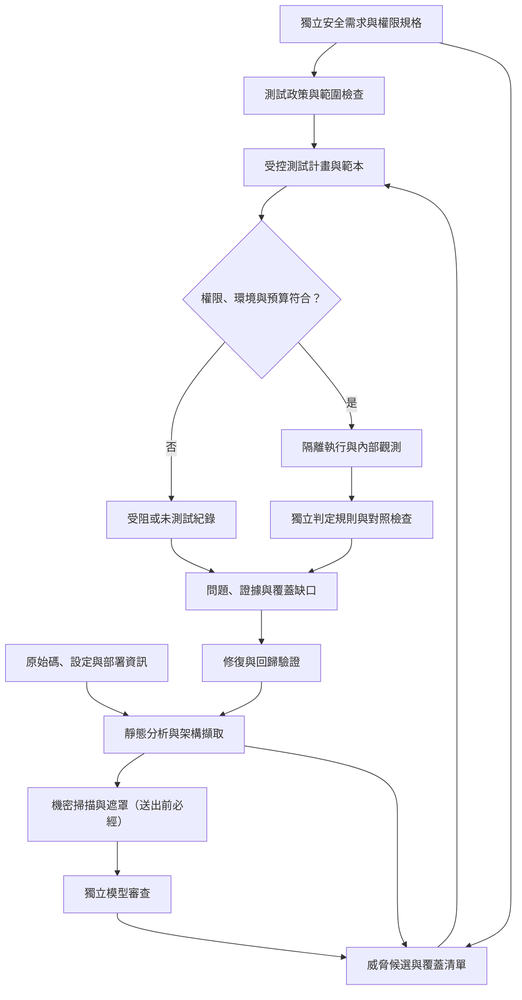
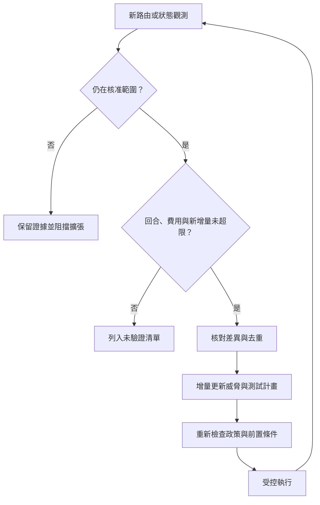

# 多代理 AI 輔助程式開發測試工具包：方法論與系統架構規劃報告

> **版本**：v1.3.3 雙審查整合修訂版（v1.3 補充：需求取得流程、首批技術棧 P0 判定、模型與工具事實修正；v1.3.2 將推定需求改為與預設政策的差異清單，並補 Next.js Proxy 與 Supabase 具體檢查；v1.3.3 新增問題指紋、已知缺口基準線、執行設定分層與機密處理順序）  
> **修訂日期**：2026-10-31（臺灣時間）  
> **修訂底稿**：`vibe-coding-multiagent-testing-toolkit-architecture(2).md`，以及本次工作中的 v1.1、v1.2 修訂稿  
> **審查輸入一**：`貼上的文字 (1).txt`，題名為《Multi-Agent Vibe Coding 測試工具包：架構合理性、事實核實與缺口審查報告》  
> **審查輸入二**：`GSMD-RPT-2026-1031-01_VibeCoding test review1.pdf`，7 頁；來源所載編號尚待正式登錄，本版不代為確認登錄狀態  
> **資訊分級**：依第二份來源標示，採「機密／僅供英業達內部使用」處理；本修訂稿未取得正式文件編號或發布核准  
> **文件狀態**：架構設計草案；可作為原型開發與驗收規格的基礎，尚非已完成實作或通過安全驗證的聲明。  
> **證據界線**：研究與工具說明已依本次審查取得的論文、官方文件及專案說明修正；未取得本工具包原始碼、模型呼叫紀錄、部署設定與端到端測試報告。兩份新增審查中的建議已分別整合為設計要求、待校準指標或限制說明；意見有衝突時依一手來源、統計分母與工程證據裁定，不以審查意見數量投票。  
> **用語**：「應／不得」表示本版建議採納的設計要求；「待驗證」表示尚無實測證據。本文的設計要求不代表引用來源逐項提出相同要求。

## 摘要

本工具包針對以自然語言驅動 AI 產生或修改程式碼的應用，規劃一套「獨立安全需求＋白箱分析＋多模型獨立審查＋威脅建模＋受控動態驗證」流程。

外層由確定性的工作流程控制器管理狀態、權限、預算、重試與證據。大型語言模型負責提出候選問題、整理架構資訊及協助選擇測試範本；模型不得自行放寬執行範圍、覆寫安全政策或決定上線放行。

動態階段使用白箱線索、測試身分與資料庫等內部觀測，因此整體定位為**白箱引導的灰箱動態驗證**。部分測試可由外部介面執行，但不將整套流程稱為純黑箱測試。

核心原則如下：

1. 功能測試通過不足以證明安全；動態利用未成功也不足以排除漏洞。
2. 多模型獨立審查用於降低互相影響與增加候選發現，不保證消除偏誤或共同盲點。
3. 程式碼擷取結果描述「目前如何實作」；獨立安全需求定義「應如何運作」，兩者不能混用。
4. 結構化輸出保證的範圍主要是資料形狀，不代表內容正確、測試安全或權限合法。
5. 容器隔離、可復原資料與受控網路是必要工程措施，但不能宣稱完全隔離。
6. 報告同時揭露已確認問題、未重現問題、受阻測試與覆蓋缺口；不得用無結果代替通過。

## 目錄

1. 研究與既有專案的證據界線
2. 適用範圍、輸入與非目標
3. 整體架構與信任邊界
4. 元件職責與權限分離
5. 架構資訊、威脅與測試的資料契約
6. 異質模型選型與適配層
7. 威脅建模與測試產生
8. 動態驗證與判定規則
9. 執行環境、提示注入與供應鏈防護
10. 狀態機、復原與預算控制
11. 證據、報告與持續整合閘門
12. 工具包自身的驗證與驗收
13. 技術棧與開發里程碑
14. 已知限制與待完成清單
15. 修訂紀錄
16. 參考資料

## 1. 研究與既有專案的證據界線

### 1.1 研究結果及可支持的結論

| 研究 | 可核對的結果 | 本工具包採用的結論與限制 |
| :--- | :--- | :--- |
| BaxBench，2025 [R1] | 392 個後端生成任務；研究中的最佳模型 o1 功能正確率約 62%；平均約半數功能正確的生成程式仍可被研究測試利用 | 功能正確不等於安全。研究結果不能直接推導功能與安全的相關係數為零，也不能當成所有企業專案的漏洞比例 |
| SUSVIBES，2025／2026 修訂 [R2] | 摘要列出 SWE-Agent 搭配 Claude 4 Sonnet 的解答約 57% 功能正確、11.8% 安全；研究測試的初步安全提示策略未能有效解決問題 | 結果須綁定模型、代理設定、資料集與指標分母。不將 11.8%～15% 寫成所有前沿代理的固定表現，也不宣稱所有安全提示都無效 |
| Last Secure Code Benchmark，2026 預印本 [R3] | 同一漏洞情境涵蓋函式、檔案、專案三種生成範圍；最佳情境級結果 12% 要求三種範圍皆通過。表 12 中六個模型的專案級「功能且安全」比例為 16.0%～30.7% | 12% 不是專案級單項通過率。比較時須明確區分任務級與情境級指標；此研究尚不能作為本工具包效果的實測證據 |
| Correlated Errors in Large Language Models，ICML 2025 [R4] | 評估超過 350 個模型；其中一個排行榜資料集上，兩模型皆答錯時，答案一致比例約 60% | 支持模型可能共享錯誤的風險；60% 不是通用相關係數或資安審查漏判率，也不能只歸因於訓練語料重疊 |
| 多代理辯論研究 [R5][R6] | 部分設定的辯論會讓正確答案轉為錯誤；另有研究顯示協定與參數調整可改善結果 | 本工具包先採獨立審查，以降低互相影響。此為工程選擇，不是「所有辯論必然無效」的結論 |
| 模型自我偏好研究 [R7] | 模型可能辨識並偏好自身生成的內容 | 隱去作者標籤與分離上下文可降低部分干擾，但不能保證消除自我偏好 |
| ThreatModeling-LLM [R8] | 研究銀行情境的資料集、提示最佳化與模型微調 | 支持領域資料與評估的重要性，不作為全面否定文字威脅建模的依據 |
| 套件幻覺研究 [R9] | 程式碼生成模型可能推薦不存在的套件 | 需要額外驗證套件來源。套件幻覺是生成錯誤；攻擊者註冊被幻覺引用的名稱加以利用，才形成相關供應鏈攻擊情境 |
| 多代理失敗分類 MAST [R10] | 歸納系統設計、代理協作及任務驗證等失敗類型 | 用於設計失敗處理與驗收案例，不代表有限狀態機本身就能消除全部失敗 |

上述比例均來自特定研究環境。不得把研究中的程式碼生成評測分數，直接當成本工具包的漏洞偵測率、漏判率或投資效益。

### 1.2 既有專案可借鏡之處

| 專案 | 本次可確認的資訊 | 整合前仍須驗證 |
| :--- | :--- | :--- |
| Shannon [R11] | 專案描述原始碼引導的動態滲透驗證；開發文件說明 Temporal 工作流程 | 固定版本的工具驅動、輸出格式、授權及隔離。未有足夠證據時，不宣稱已內建 Schemathesis |
| Strix [R12] | 官方說明多代理、Caido、動態驗證及修復相關能力 | 區分開源版、雲端服務與企業功能；特定 `strix fix` 指令及整合工具須以版本化文件或程式碼確認 |
| Reaper [R13] | 官方說明 HTTPS 攔截、流量搜尋及本機資料庫紀錄 | 通訊介面、儲存引擎、代理設定、憑證與可觀測流量範圍；本版不將 Unix 通訊端或 SQLite 細節視為已完成整合 |
| DARPA AIxCC [R14] | Team Atlanta 獲冠軍、Trail of Bits 獲第二名 | 可借鏡 AI 與程式分析、模糊測試的結合；名次不證明任何固定工具組合對所有漏洞都必要或充分 |

專案維護者的功能說明屬於**維護者主張**；只有本工具包在固定版本、設定與測試集下取得的結果，才能稱為**整合實測**。

### 1.3 案例爭議與標準適用範圍

原始報告曾以 `CVE-2025-48757` 作為 Lovable／RLS 案例。NVD 與 CVE 官方紀錄均可確認該編號，並帶有 `disputed` 與 `exclusively-hosted-service` 標記；供應商爭議涉及客戶對應用資料保護的責任 [R33]。

因此本版只將其列為**存在爭議的公開案例**，不當成所有 Lovable 或 Supabase 應用皆有相同漏洞的證據。存在爭議不代表風險已被排除，也不能用爭議紀錄代替本工具包樣本的基準答案。RLS 測試仍以個別應用需求、有效政策與實際存取結果為準。

ASVS 5.0 不再保證第 1 級要求可全部透過純黑箱驗證，並鼓勵取得文件與原始碼等資訊 [R15]。這不等於禁止黑箱方法，也不表示每一項第 1 級要求皆必須取得原始碼；各項驗證方法須依要求決定。

### 1.4 證據標示與審查衝突處理原則

| 標示 | 可支持的內容 | 不可擴大為 |
| :--- | :--- | :--- |
| 已核對的一手紀錄 | 官方文件載有的功能、模型、狀態，或論文明確定義的結果 | 本工具包已整合成功，或研究結果已由本團隊獨立重現 |
| 廠商／專案主張 | 維護者對能力、效果或內部機制的說明 | 已驗證的安全性、準確率或完整覆蓋 |
| 研究／第三方結果 | 指定研究條件下的觀測與論點 | 所有企業專案的通用比例或保證 |
| 工程建議／推論 | 本版提出的設計取捨、門檻與優先序 | 外部標準強制要求或已完成的功能 |
| 待驗證 | 尚缺來源、實測或適用性確認 | 不存在、不適用或安全 |

「確認論文寫了某數字」與「獨立重現該數字」分開記錄。來源存在，也不代表原文件的統計口徑正確。兩份審查與本版裁定的差異集中列於第 14.4 節，避免修訂時把先前已更正內容重新改回。

## 2. 適用範圍、輸入與非目標

### 2.1 第一階段原型範圍

建議先支援單一可重現的網站技術棧，例如 TypeScript／Next.js 搭配 PostgreSQL／Supabase 測試環境。框架、執行環境、資料庫及工具版本應在原型啟動前固定，列入支援矩陣；本文不指定尚未驗證的版本組合。

優先檢查：

- 身分驗證與授權、跨租戶與同租戶跨使用者的資料存取。
- 資料表權限、資料列層級安全政策、機密欄位與前端建置產物。
- 敏感欄位覆寫、業務狀態轉移、重放與併發一致性。
- 套件來源、已知弱點、設定錯誤與機密資訊洩漏。
- 依專案需求加入注入、伺服器端請求偽造、檔案操作及瀏覽器端安全測試。

完整記憶體安全分析、任意語言支援、未授權外部測試、正式環境破壞性測試，以及完整合規認證，不屬於第一階段目標。若後續支援原生程式碼，需另設建置、模糊測試與記憶體錯誤偵測工具的能力規格。

### 2.2 必要輸入

| 類別 | 必要內容 | 缺少時的處理 |
| :--- | :--- | :--- |
| 受測範圍 | 原始碼提交識別碼、受測端點、允許操作與資料範圍 | 不啟動動態測試 |
| 獨立安全需求 | 角色權限、資源擁有權、租戶隔離、資料分類、合法狀態轉移 | 依第 2.4 節的需求取得流程產生候選並交付確認；未確認前不得從現有實作自行推定允許行為 |
| 部署資訊 | 建置方式、環境變數名稱、外部相依服務、測試替代服務 | 標示環境差異與受阻項目 |
| 測試身分 | 不同角色、租戶、同租戶不同使用者、服務身分與停用／過期狀態 | 不支援的矩陣格列入缺口 |
| 測試資料 | 合成資料、擁有權標記、唯一識別標記及初始化方法 | 不使用正式機敏資料補位 |
| 復原方式 | 資料庫、快取、物件儲存、佇列、背景工作與回呼重置 | 無法安全復原的測試不執行 |
| 執行限制 | 費用、時間、請求量、併發、模型供應商及網路允許清單 | 缺少限制時不得採用無上限預設值 |

獨立安全需求由應用負責人提供或確認；資安人員確認風險與測試政策；平台維運人員確認沙盒與憑證邊界。工具包保留確認紀錄，但不得自行推定人員已完成核准。

### 2.3 測試能力與優先序矩陣

下列優先序是開發規劃，不是弱點嚴重程度。P0 為首批支援情境必須具備的基礎；P1 為後續核心擴充；P2 為依情境擴大。應用若已有強制安全或法遵要求，相關項目立即提升為必要驗證，不因表中排序而延後。

本表是跨技術棧的通用優先序。標示「限採用此框架」或「依技術棧判定」的項目，以第 2.5 節的技術棧 P0 清單為準；不使用「若有此流程即納入」這類附條件寫法，避免 P0 範圍無法驗收。

| 安全領域 | 優先序 | 必要輸入與判定重點 | 目前交付狀態 |
| :--- | :--- | :--- | :--- |
| 身分、工作階段、JWT | P0 | 身分有效性、撤銷、過期、受眾與權限；對照合法與無效身分 | 設計要求；未附驗收證據 |
| 物件、功能及欄位授權 | P0 | 主體與資源關係、動作、情境及共享例外；讀取與寫入分開 | 設計要求；未附驗收證據 |
| Supabase RLS 與儲存政策 | P0，限採用此框架的專案 | 資料表、物件儲存、下載與簽署連結；政策與部署現況一致性 | 框架模組待實作／驗收 |
| 機密資訊與前端產物 | P0 | 原始碼、環境變數用途、實際可下載產物及來源映射檔 | 範圍與規則待驗收 |
| 套件來源與幻覺套件 | P0 | 名稱、版本、來源、發布者與安裝腳本；存在性不等於可信度 | 專用來源驗證待實作／驗收 |
| SQL、指令及瀏覽器指令碼注入 | P1 | 專用輸入與安全斷言，不只檢查伺服器錯誤 | 個別測試類型待驗收 |
| 伺服器端請求、路徑與檔案上傳 | P1 | 範圍受限回呼、檔案權限、內容與儲存副作用 | 個別測試類型待驗收 |
| 回呼簽章、重放與冪等性 | 依技術棧判定（見第 2.5 節） | 合法／無效簽章、有效時間窗、事件識別與重複送達 | 專用狀態範本待驗收 |
| 跨站請求、跨來源政策與 Cookie | P1 | 瀏覽器實際行為與獨立政策，不只掃描標頭名稱 | 瀏覽器對照測試待驗收 |
| Next.js Server Actions、Route Handlers 與 Middleware／Proxy | P0，限採用此框架的專案 | 動作識別碼與路由盤點、直接呼叫時的身分與授權、Middleware／Proxy 比對範圍外的路徑，不能只測畫面 | 框架模組待實作／驗收 |
| GraphQL | P1 | 欄位、解析器、內省與批次查詢的授權及資源耗用 | 框架模組待實作／驗收 |
| 限流與資源耗用 | P1 | 核准負載上限、業務額度、成本與可用性影響 | 受限負載測試待驗收 |
| 基礎設施、容器與持續整合設定 | P1 | 部署權限、掛載、機密取得、建置與發布隔離 | 設定掃描與執行驗證待驗收 |
| 受測應用的 AI 代理／MCP | P1，僅適用具此能力的應用 | 工具權限、資料外送、委派與不可信內容 | 支援範圍待定義 |
| 軟體組成分析與 SBOM | P1 | 建置產物、直接與間接依賴、元件版本與弱點資料庫版本 | 證據產出流程待驗收 |
| 加密、稽核與隱私控制 | P2 擴充；必要控制立即納入 | 金鑰使用、資料分類、紀錄完整性與保存政策 | 自動與人工驗證分工待定義 |

測試平台本身的代理工具權限、機密保護與提示注入防護屬 **P0**，不因受測應用的 AI 功能列為 P1 而延後。

框架支援採可插拔模組。每個模組宣告：適用版本、可辨識的結構、所需證據、支援測試範本、判定器、已知限制及自我驗收樣本。沒有載入對應模組時，相關能力標示不支援，不能以一般 HTTP 掃描假裝已涵蓋。

### 2.4 安全需求取得流程

以自然語言驅動 AI 產生的專案，通常沒有現成的角色權限矩陣、資源擁有權或合法狀態轉移規格。若只規定「缺少需求時保留待確認」，多數授權測試會停在受阻，工具包無法產生實際價值。因此本版將需求取得列為獨立流程，產出符合第 5.1 節「安全需求」欄位的紀錄，並保留每條需求的來源與確認狀態。

**需求來源與可信程度：**

| 來源 | 產生方式 | 確認前的用途 | 確認後的用途 |
| :--- | :--- | :--- | :--- |
| S1：既有規格 | 應用負責人提供的權限矩陣、產品規格、合約或法遵要求 | 視為待確認輸入 | 可作判定依據 |
| S2：預設政策範本 | 工具包提供的保守預設，例如「資源預設僅擁有者可讀寫」「租戶間預設完全隔離」「管理功能預設僅限管理員」「未登入者預設不可寫入」 | 可執行候選測試，但據此產生的發現最多列為「證據待補」 | 負責人逐條接受或標記例外後，可作「已確認」問題的判定依據 |
| S3：與預設政策的差異清單 | 以 S2 為基準，比對程式碼、資料表結構、角色欄位與既有政策檔，列出「實作看起來允許、但預設政策拒絕」或反之的差異；每項附實作位置與對應的預設條文 | 標示「偏離預設、待確認」；不改變 S2 的判定，只用於排序與補問 | 負責人確認為合法例外後，該例外才覆寫對應的 S2 條文；未確認者維持 S2 判定 |
| S4：觀測補充 | 動態執行中發現的新角色、資源或狀態轉移 | 依第 10.5 節轉為新候選，不自動成為需求 | 同 S3：以與預設政策的差異交付確認，判定為合法例外後才覆寫預設 |

**流程：**

1. 載入適用技術棧的預設政策範本（S2），以及負責人提供的既有規格（S1）。
2. 以 S1 與 S2 為基準比對靜態擷取結果，產生差異清單（S3）。S3 只描述「實作與預設政策哪裡不同」，不從實作反推「應該允許什麼」。
3. 將 S1、S2 條文與 S3 差異合併成一份確認清單，依影響範圍排序，交給應用負責人處理：S1、S2 條文可接受、修改或標記不適用；S3 差異只能判定為「合法例外」（附理由、範圍與到期條件）或「維持預設」。
4. 未處理的 S1 需求維持待確認，依賴它的測試標示受阻；尚未接受的 S2 條文仍可執行測試，但發現最多列為「證據待補」。報告列出各類待確認數量。
5. 確認紀錄保存確認者、時間、需求版本與範本版本；需求變更時產生新版本，既有判定紀錄維持原版本關聯。

**防止循環論證：**

- 差異清單若由模型協助產生，不得由同一次執行中提出問題候選的同一模型工作者產生；兩者分屬不同工作，各自保存來源。此項只降低互相影響，主要防護仍是下一條「實作現況不得成為需求來源」。
- 實作現況不得成為需求來源。程式碼缺少擁有者檢查時，S3 只能列出「此處偏離『僅擁有者可讀寫』預設」，不得產生「此資源為公開」的候選需求；漏洞因此以「偏離預設」的形式出現，而不會被包裝成既有需求。
- S3 差異在負責人判定前，測試仍依 S2 預設政策判定；判定為合法例外後，才以例外條文取代對應預設，並保存原預設條文與例外理由。
- 以 S2 判定的發現，若對應條文尚未經負責人接受，最多列為「證據待補」，不得列為「已確認」。
- 預設政策範本須版本化並附自我驗收樣本，範本本身的錯誤不能由受測專案的結果反推修正。

**導入成本：**

需求確認是本工具包最主要的人工負擔。原型階段須量測每個專案的待確認需求數、平均確認時間、例外比例與因需求未確認而受阻的測試比例；若確認負擔過高，優先改善預設範本與排序方式，不得以自動接受差異清單或預設條文代替確認。

### 2.5 首批技術棧的 P0 攻擊面

第 2.3 節的通用優先序須依實際技術棧落實。首批支援 TypeScript／Next.js 加 PostgreSQL／Supabase 時，下列攻擊面為 P0；在盤點中確認不存在者，以第 11.4 節的「不適用」紀錄排除，並附理由與確認者。

| 攻擊面 | 盤點方式 | P0 判定重點 |
| :--- | :--- | :--- |
| Next.js Server Actions | 由建置產物與原始碼交叉擷取動作識別碼及對應函式；動作不會出現在一般路由表，必須獨立盤點 | 繞過畫面直接呼叫時的身分、物件授權與輸入驗證 |
| Next.js Route Handlers | 依 App Router／Pages Router 規則擷取路由與方法 | 身分、物件與功能授權；錯誤回應不洩漏資料 |
| Next.js Middleware／Proxy | 依 Next.js 版本擷取 `middleware.ts`（v15 以前）或 `proxy.ts`（v16 起 Middleware 已棄用並改名為 Proxy）[R40]；擷取比對規則（matcher）與實際執行順序 | 比對範圍外的路徑是否仍受保護；不以 Middleware／Proxy 作為唯一授權層。Server Functions 不是獨立路由，而是以 POST 送到所在頁面路徑，matcher 排除該路徑時也會一併略過 Proxy [R40]，因此須逐一檢查每個 Server Action 所在路徑是否落在 matcher 範圍外，以及動作內部是否自行驗證身分與授權 |
| 瀏覽器直連 Supabase 資料 API | 擷取前端用戶端呼叫、資料表與 RPC 函式，對照實際啟用的 RLS 政策 | 依第 8.2 節逐操作驗證；以一般使用者身分經資料 API 測試 |
| Supabase Storage | 擷取儲存桶、路徑規則、簽署連結與儲存政策 | 跨使用者讀取、覆寫、列舉及簽署連結有效期 |
| Supabase Edge Functions | 擷取函式清單、驗證設定與呼叫來源 | 未驗證呼叫、服務金鑰使用範圍與授權 |
| 前端建置產物與環境變數 | 檢查實際可下載產物、來源映射檔與公開環境變數；掃描規則同時涵蓋新版 `sb_secret_` 金鑰與舊版 `service_role` JWT [R41] | 機密金鑰或其他機密不得出現在前端；Supabase secret key 會略過所有 RLS 政策，出現在前端即視同資料庫可被任意存取 [R41] |
| Webhook 與第三方回呼 | 擷取回呼端點及其驗證邏輯 | 簽章驗證、重放與冪等性；專案有付款或第三方回呼時，不得延後 |

上述盤點結果併入第 11.4 節的覆蓋分母。任一 P0 攻擊面的框架模組尚未完成時，報告須標示該面向不支援，不能因其他面向通過而顯示首批技術棧已完整涵蓋。

## 3. 整體架構與信任邊界

### 3.1 主流程



### 3.2 必須分開的信任邊界

1. **控制與政策區**：工作流程、預算、工具允許清單、判定規則及證據索引；受測應用不可寫入。
2. **模型審查區**：只取得核准的程式碼與架構內容；不直接持有部署或正式環境憑證。
3. **測試執行區**：執行受限腳本，僅可接觸核准的測試目標與資料。
4. **受測應用區**：視為不可信程式，不能控制測試器、判定器或證據保存區。
5. **外部模型與服務區**：經資料分類、供應商政策與網路規則後才可使用；本機模型失敗時不得自動將敏感內容轉送外部。

應用的資料流圖另外標記瀏覽器、後端、資料庫、第三方服務與跨租戶邊界。部署於不同程序或容器不必然代表不同授權邊界；反之，共用資料庫內仍可能存在重要租戶邊界。

### 3.3 五個功能層與兩項橫向能力

| 功能層 | 主要產物 | 對應章節 |
| :--- | :--- | :--- |
| 專案入口與政策控管 | 掃描宣告、授權範圍、資料分級與預算 | 第 2、9、10 章 |
| 程式結構與靜態分析 | 可追溯架構資訊、靜態告警及盤點缺口 | 第 4、5 章 |
| 獨立模型審查與威脅建模 | 候選問題、資料流與威脅中介資料 | 第 6、7 章 |
| 測試轉換與受控驗證 | 測試中介資料、執行證據與判定 | 第 7、8 章 |
| 證據、報告與修復 | 問題狀態、覆蓋報告、回歸與閘門結果 | 第 11、12 章 |

**安全治理**橫跨所有層：最小權限、資料路由、供應商政策、憑證與網路控制。**可觀測性**也橫跨所有層：執行追蹤、版本、費用、錯誤、覆蓋與稽核。這是對既有方法論的工程分層，不表示五層都已實作。

### 3.4 擴充資料流盤點

資料流盤點不得只描述瀏覽器、後端與資料庫三者。依專案實際使用情形，還應列出：

- 前端直接存取 BaaS 或物件儲存的路徑。
- 第三方 OAuth／身分提供者、回呼與帳號連結流程。
- Webhook、排程、背景工作、訊息佇列及重試處理。
- 建置與持續整合流程、套件登錄庫、機密管理與發布身分。
- 若適用，模型供應商、MCP 伺服器、工具代理與資料外送路徑。

每一路徑記錄方向、發起身分、資料類別、授權與驗證位置、可能副作用及觀測方式。無法確認的路徑保留為待確認，不從圖與覆蓋分母中靜默刪除。

## 4. 元件職責與權限分離

| 元件 | 主要職責 | 不得擁有的能力 |
| :--- | :--- | :--- |
| 工作流程控制器 | 維持狀態、排程、取消、復原與成果索引 | 不因模型建議而放寬範圍或刪除受阻紀錄 |
| 政策與預算檢查器 | 驗證目標、操作、資料路由、費用預留與資源限制 | 不由受測原始碼或模型輸出覆寫規則 |
| 架構擷取器 | 語法解析、框架規則、路由與部署資訊交叉核對 | 不將無法解析內容當成不存在 |
| 靜態掃描器 | 機密資訊、已知弱點、設定及規則掃描 | 不把掃描無結果解讀成完整安全證明 |
| 模型審查工作者 | 讀取核准內容，提出候選問題與證據位置 | 不執行任意命令，不取得其他模型即時結論 |
| 威脅建模器 | 整合安全需求、候選架構及問題，建立威脅與覆蓋清單 | 不只分析已被模型告警的路由 |
| 測試產生器 | 將支援的威脅轉為受控範本及參數 | 不任意下載工具或自行決定外部目標 |
| 環境建置與認證管理器 | 執行核准建置配方、遷移、合成資料、測試認證及環境差異檢查 | 不自動修改安全控制來讓測試能跑；不使用正式個人憑證 |
| 測試執行器 | 在核准環境執行並收集結果 | 不取得宿主機管理權限或模型供應商金鑰 |
| 判定器 | 比對獨立預期結果、正向對照與副作用 | 不接受受測程式直接宣告通過 |
| 證據與報告元件 | 保存脈絡、遮罩敏感資訊、產出報告與修復追蹤 | 不只輸出成功利用的問題而隱藏其餘缺口 |

Tree-sitter 負責建立語法樹，不等同跨檔案語意分析或完整資料流分析 [R16]。各框架擷取規則必須標示支援版本，並對動態路由、產生碼、中介軟體順序與部署差異設定補充觀測方式。

## 5. 架構資訊、威脅與測試的資料契約

### 5.1 共用欄位

所有中介資料須具備 `schema_version`、`run_id`、唯一識別碼、建立時間及來源識別碼。原始碼位置須綁定提交識別碼；行號本身不足以識別證據。

| 資料類型 | 最低必要欄位 |
| :--- | :--- |
| 架構資訊 | 元件、端點／資料流、來源檔案與位置、擷取方法、框架版本、觀測或推定狀態、尚未解析範圍 |
| 安全需求 | 需求識別碼、來源與確認狀態、主體、動作、資源、條件、允許／拒絕規則 |
| 問題候選 | 問題識別碼、相關需求、來源位置、可能影響、前置條件、可用證據、提出者、驗證狀態 |
| 測試計畫 | 目標、身分、測試資料、前置條件、範本版本、允許操作、預期結果、觀測方式、停止條件、復原方法 |
| 執行結果 | 開始與結束時間、工具版本、輸入摘要、結果狀態、錯誤原因、證據參照、資源與費用 |
| 判定紀錄 | 需求識別碼、判定規則版本、正向對照、實際結果、問題狀態、限制與覆核者 |

候選問題的弱點分類可以暫時未知；不得為了填滿 `cwe_id` 而捏造分類。模型自評信心僅供排序，不直接當成漏洞成立機率或風險等級。

### 5.2 範例：受控授權測試宣告

以下為格式示例，不代表已存在的執行紀錄。正式實作應提供版本化 JSON Schema，檢查欄位型別、列舉、識別碼關聯及跨欄位條件。

```json
{
  "schema_version": "1.0",
  "test_id": "AUTHZ-001",
  "requirement_id": "REQ-DOCUMENT-OWNER-READ",
  "template_id": "cross-user-read-v1",
  "target_ref": "local-test-app",
  "actor_ref": "tenant-b-user",
  "resource_ref": "tenant-a-private-document",
  "preconditions": [
    "resource_exists",
    "owner_read_succeeds",
    "actor_session_valid",
    "resource_not_public_or_shared"
  ],
  "expected": {
    "protected_data_disclosed": false,
    "unauthorized_state_change": false
  },
  "limits": {
    "max_requests": 10,
    "timeout_seconds": 30
  },
  "cleanup_ref": "reset-document-fixture-v1"
}
```

`target_ref`、`actor_ref`、`resource_ref` 必須由可信設定解析；模型不能藉由填入任意網址、檔案路徑或權杖跳過範圍檢查。

### 5.3 去重與追溯

去重應以需求、資源、根因與證據為依據，保留原始候選及提出者關聯。語意相似不表示同一根因；不同租戶、不同入口或不同權限路徑不得僅因描述類似就合併刪除。

具體證據不足的候選可以進入補證隊列。缺少完整程式路徑不等於誤報，也不得讓「必須有完整路徑」成為所有漏洞類型的硬性排除條件。

### 5.4 七種核心資料物件

以下命名作為本工具包的內部契約，與第 5.1 節欄位要求對應。名稱確立不代表正式 JSON Schema 已交付；開發階段仍須建立結構檔、相容性與移轉測試。

| 物件 | 用途與關鍵欄位 | 主要關聯 |
| :--- | :--- | :--- |
| `ScanManifest` | 提交與產物摘要、範圍、授權來源、資料分級、模型政策、預算、操作限制與基線版本 | 每次執行的不可變設定快照 |
| `CodeFact` | 從程式與設定擷取的結果、來源位置、擷取方法、支援版本與未解析內容 | 連結提交及元件／資料流 |
| `ThreatIR` | 威脅、需求、信任邊界、弱點分類、前置條件與候選證據 | 連結需求及 `CodeFact`；允許未知分類 |
| `TestIR` | 範本、目標、身分、資源、步驟、前後置條件、斷言、限制與清理 | 連結 `ThreatIR`、需求及 `ScanManifest` |
| `ExecutionRecord` | 工具、模型、環境、時間、請求與回應參照、狀態差異、錯誤、費用及清理結果 | 連結 `TestIR` 或模型／靜態工作 |
| `FindingRecord` | 問題指紋與指紋演算法版本、根因、影響、風險等級、證據類型、信心來源、狀態、修復及覆核紀錄 | 連結威脅、執行證據與修補提交；以指紋跨次比對（第 5.6 節） |
| `CoverageRecord` | 盤點來源、適用範圍、分母、已執行、有效判定、受阻、未測與不支援項目 | 連結需求、端點、權限組合及執行紀錄 |

執行期觀測以 `ExecutionRecord` 或明確型別的觀測資料保存；模型推定留在 `ThreatIR`／候選資訊，不偽裝成確定性 `CodeFact`。`CodeFact` 也不代表零錯誤：擷取器仍須以基準答案量測錯擷取與漏擷取。

所有證據參照包含內容摘要、類型、擷取時間、來源與存取等級；摘要只協助偵測位元組變更，不能單獨證明來源可信。控制區須另外確保寫入權限與封存紀錄。

七種核心物件之外，增加三種相依紀錄：`EnvironmentProfile` 保存環境類型、服務版本、實際身分路徑與已知差異；`BuildRecipe` 保存建置、遷移、種子資料、認證取得、健康檢查與復原步驟。兩者版本與摘要由 `ScanManifest`、`TestIR` 及 `ExecutionRecord` 參照，不把大量可變環境內容直接複製到每項問題中。`BaselineRecord` 保存已知缺口基準線的項目、負責人、理由與到期日，由 `ScanManifest` 的基線版本欄位參照，用途見第 11.7 節。

### 5.5 中介格式轉換契約

`ThreatIR` 轉換為 `TestIR` 前須通過：需求已確認、目標在範圍內、必要身分與資料可用、範本適用、判定器可觀測、限制與清理策略存在。

轉換結果包含成功、不支援、前置條件不足或格式／語意錯誤。每次轉換記錄規則版本、輸入與輸出摘要，以及未能轉換的原因。結構版本不相容時應拒絕或走已驗證的移轉器，不自動忽略未知欄位。

範本參數化可使用確定性程式；若某步驟由模型補足，必須標示來源並重新檢查，不把整條轉換鏈宣稱為完全確定。

### 5.6 問題指紋與跨次比對

每個 `FindingRecord` 須有穩定的問題指紋，用來判斷不同提交、不同執行之間是否為同一問題。沒有指紋，就無法做到「只顯示新增問題」、延續誤報與例外標記，也無法在問題再次出現時重新開啟原紀錄（第 11.5 節）。

**指紋組成：**

| 問題類型 | 指紋欄位 |
| :--- | :--- |
| 授權與業務邏輯 | 需求識別碼（或預設政策條文識別碼）、根因類別、正規化入口、資源類型、主體與資源的關係（例如「同租戶非擁有者」） |
| 資料庫政策 | 需求或條文識別碼、根因類別、資料表／檢視表／函式的限定名稱、操作類型 |
| 機密資訊暴露 | 偵測規則識別碼、機密類型、以專案層級鹽值計算的機密雜湊、暴露位置類別（原始碼、前端產物、建置紀錄等） |
| 設定與套件 | 規則識別碼、元件識別（套件名稱與來源登錄庫）、設定項名稱 |

「正規化入口」指 HTTP 方法加正規化路由（路徑參數改為佔位符），或 Server Action 的模組路徑加匯出函式名稱。

**不得放入指紋的欄位：** 行號、提交識別碼、建置時產生的動作識別碼或雜湊、時間、執行識別碼，以及模型產生的描述文字。這些欄位每次都可能改變，放入會讓同一問題被當成新問題。程式碼位置與符號名稱保存為輔助比對資訊，不作為身分依據。

**比對規則：**

1. 指紋完全相同：視為同一問題，延續原紀錄的狀態、例外與歷史。
2. 只有正規化入口不同（例如路由改名、Server Action 搬移）：列為「可能相同」，附上輔助比對資訊交由覆核，不自動合併。
3. 一個問題拆成多個，或多個合併為一個：保存前後指紋的關聯，不刪除原紀錄。
4. 指紋演算法須版本化；演算法變更時提供新舊指紋的對照，未能對應者列出數量，不靜默視為新問題或已修復。

指紋只用於跨次識別，不取代第 5.3 節的去重規則；同一次執行中，不同入口或不同權限路徑仍是不同問題。

## 6. 異質模型選型與適配層

### 6.1 候選模型配置

本表表示文件核對與選型意圖，**不表示已完成 API、帳號權限或整合測試**。模型、端點與版本應放在設定檔，不寫死於業務邏輯。

| 模型家族 | 本版候選 | 核對與限制 | 整合狀態 |
| :--- | :--- | :--- | :--- |
| Anthropic | `claude-sonnet-5-5`、`claude-opus-5-5` | 官方模型文件列有名稱；原生 Messages API 使用 `output_config.format`，SDK 可使用 `messages.parse()` [R24][R25]。這兩個模型不接受強制工具呼叫（`tool_choice` 為 `any` 或 `tool` 時回傳 400），適配層不得以強制工具呼叫取得 JSON [R39] | 待實測 |
| NVIDIA | `nvidia/nemotron-3-super-120b-a12b` | 官方描述為 Mamba-2 與專家混合層交錯、搭配少量 Attention 層的混合模型 [R26]。2026-10-31 查詢 NIM `/v1/models` 仍列有此模型；原稿「免費端點標示淘汰」尚缺公告日期與連結，列為待驗證 | 需先確認可用部署、端點與淘汰時程，再驗證結構化輸出 |
| Google | `gemini-4-argon`；`gemini-2.5-pro` 僅限既有帳號 | 依選定模型及 SDK 版本確認上下文與結構化輸出能力；Argon 有官方模型文件 [R27]。官方模型頁註明 Gemini 2.5 系列未棄用，但僅開放給先前使用過的帳號 [R38]，新原型不以其為預設候選 | 待實測 |
| OpenAI | `gpt-6.1-sol` | 官方模型文件列有名稱；優先採 Responses API；其他端點是否適用應另行確認 [R28] | 待實測 |

模型調整理由：

- 不再以 Llama-3.3-Nemotron-Super-49B-v1.5 支持「非純 Transformer」選型理由；其模型卡描述為稠密解碼器式 Transformer [R31]。此調整不代表該模型不存在。
- `o3` 已公告於 2026-12-11 停止服務，因此不作本版新建原型的預設候選 [R29]；截至修訂日，「已公告淘汰」不等於「已停止服務」。
- `gpt-5.4` 有官方模型頁與版本識別碼 [R30]；本版僅因選型收斂而不納入，不以「官方不存在」作為理由。
- 模型能力分工屬待驗證假設。應以相同資料與預算比較，不能僅依品牌印象指定某模型必然較擅長某類漏洞。

### 6.2 本機部署的名稱與能力

分開記錄權重來源、權重版本、推論引擎、量化方式、硬體、服務別名與對外 API 名稱。以 vLLM 為例，服務別名可以透過 `--served-model-name` 設定；未設定時依模型參數決定 [R32]。

`nvidia/nemotron-3-super` 若被採用，應標為本專案的部署別名，不視為 vLLM 或其他引擎的固定官方名稱。各引擎是否支援該權重、結構化輸出與思考內容分流，均須按版本驗證。

離線部署另須驗證模型與套件下載、遙測、更新及備援路由；使用本機模型本身不等於保證資料不外流。

### 6.3 結構化輸出與錯誤處理

1. **內部標準格式與供應商轉換分離**：內部保持完整欄位限制，適配器依供應商支援範圍轉換；回傳後再以內部格式驗證。
2. **不得混淆選填規則**：Anthropic 官方文件支援選填欄位 [R25]。工具包可自行選擇全部必填並允許空值的共同格式，但要標為內部策略，不宣稱所有供應商皆強制如此。
3. **區分 API 與 SDK**：Anthropic 原生 API 的舊 `output_format` 欄位已改為 `output_config.format`；SDK `messages.parse(output_format=型別)` 仍可使用同名參數並進行轉換 [R25]。
4. **按回應類型擷取最終內容**：不假設所有模型均以 `<think>` 表示推理；不得依賴取得完整內部思考過程。
5. **格式以外仍需語意檢查**：確認檔案、行號、資源與需求參照存在，且與該次提交一致；模型提供的程式路徑先視為候選證據。
6. **明確處理拒答、截斷與限流**：拒答、空回應、格式錯誤、逾時、限流或端點不可用均記錄為工作者結果，不能變成「未發現漏洞」。
7. **備援受政策限制**：每次換模型、換供應商或換端點都重新確認資料路由與費用，並保留紀錄。
8. **不依賴強制工具呼叫取得結構化資料**：部分模型不接受強制指定工具（例如 Anthropic Claude Opus 5.5／Sonnet 5.5）[R39]。結構化資料一律走各供應商的結構化輸出參數；工具呼叫只用於真正需要工具的步驟。

適配器驗收至少涵蓋正常回應、選填欄位、拒答、截斷、串流中斷、限流、格式合法但內容錯誤、不支援參數（如強制工具呼叫）的錯誤回應，以及禁止外送內容的路由阻擋。

### 6.4 模型登錄與執行前能力檢查

建立可設定的模型登錄表，至少記錄供應商、模型識別碼、端點、允許資料類別、處理區域與保存條件、上下文／輸出限制、價格及有效日期、結構化輸出能力、工具呼叫能力、適配器版本、可用狀態與淘汰資訊。

每次執行先核對設定與快取的能力驗證是否仍有效；需要探測時使用無敏感資訊的最小請求，且其費用也須預留。帳號可用、模型存在、功能支援與資料政策符合是不同檢查，不能相互替代。

僅對本階段啟用的供應商要求適配器驗收；未啟用者標為未支援或待驗證，不要求 MVP 一開始同時完成四家。後續每加入一家，都需通過相同的成功與異常情境測試。

## 7. 威脅建模與測試產生

### 7.1 需求、實作與執行資訊三方核對

威脅建模輸入包括獨立安全需求、靜態擷取及執行觀測。每一條資料流標示來源、資料類別、身分、授權條件、接收者與信任邊界，並區分已觀測與推定資訊。

OTM 或 pytm 可作為交換或建模格式候選，但自訂資料結構不會自動與其相容。需要版本對應、欄位映射、無法表達欄位及往返轉換測試。

威脅清單應覆蓋整個盤點範圍；即使所有模型都未告警，已列入需求的敏感流程仍須評估。

### 7.2 STRIDE 作為檢查框架

| 類型 | 檢查方向 | 可執行或人工驗證例子 |
| :--- | :--- | :--- |
| 身分冒用 | 憑證、工作階段、簽章與服務身分 | 無效／過期身分、回呼簽章與受眾檢查 |
| 資料竄改 | 欄位與狀態完整性 | 不允許欄位覆寫、價格與訂單狀態變更 |
| 否認行為 | 敏感操作的可歸責性 | 稽核紀錄是否包含主體、動作、資源與結果，是否可被竄改 |
| 資訊洩漏 | 跨租戶、敏感欄位、檔案與機密資訊 | 非擁有者讀取、下載連結及前端產物檢查 |
| 阻斷服務 | 資源耗用與服務可用性 | 在核准上限內檢查輸入大小、查詢成本與限流 |
| 權限提升 | 功能與物件授權 | 一般使用者執行管理操作、租戶管理員跨租戶操作 |

同一威脅可有多種影響。雙重花費或競爭條件應按完整性、授權與可用性影響分類，不固定對應為否認行為或阻斷服務。

OWASP API Security Top 10 用於分類與檢查提示，不當成完整需求清單；ASVS 項目則需固定版本並逐項確認適用性 [R15]。

### 7.3 受控轉換取代任意程式碼產生

第一階段採「模型提出測試宣告、確定性程式選取已驗證範本」方式：

1. 檢查需求是否已確認、目標是否在範圍內。
2. 檢查身分、資源、初始狀態與觀測能力。
3. 選取有版本與驗收案例的範本，填入受限參數。
4. 檢查副作用、費用、請求量、網路範圍及清理方式。
5. 執行並交給獨立判定器。

無法安全轉換的威脅保留為「不支援」或「需人工驗證」，不產生假的測試成功結果。若後續開放模型生成任意腳本，須另外設計程式審查、執行權限與隔離驗收。

威脅模型也服務設計決策與風險溝通；無法自動轉成測試的威脅仍有治理價值。

## 8. 動態驗證與判定規則

### 8.1 多身分授權矩陣

矩陣以「主體、角色、租戶、資源關係、動作、狀態」為維度，不只設定四組帳號。

至少涵蓋匿名者、擁有者、同租戶非擁有者、其他租戶使用者、租戶管理員及適用的系統／服務身分；依需求加入停用帳號、撤銷授權、過期工作階段及明確共享資源。

每一個拒絕案例應驗證：

1. 資源確實存在，且合法身分能完成對照操作。
2. 測試身分有效，且確實以預期身分發送請求。
3. 不應取得的資料未洩漏，不應執行的狀態變更未發生。
4. 回應與背景副作用皆符合需求。

不要求所有安全結果必須是 403 或 404。空集合、欄位遮罩或其他結果可依契約判定；200 不是漏洞充分條件，403 也不是安全充分條件。

Playwright 的不同瀏覽器或請求環境可用於隔離測試狀態 [R22]。實作時應確認 Cookie 與權杖的傳遞方式；載入瀏覽器儲存狀態不代表任意 HTTP 呼叫會自動使用所需的授權標頭。

授權規格應能表達角色型、屬性型及關係型控制（RBAC／ABAC／ReBAC）。同租戶比較只是可能條件之一；還需確認共享、委派、跨組織角色、時間條件及撤銷行為。合法例外必須有明確規格與正向測試，不因「跨租戶」字樣就自動判定為越權。

### 8.2 資料庫與 RLS

RLS 檢查須同時考慮資料表／欄位權限、角色、讀寫操作、政策、資料敏感性、函式及檢視表等存取路徑。

- `USING (true)` 可是公開資料的合法讀取政策，不自動判定為漏洞 [R19]。
- 公開用途的 API 金鑰不等同機密服務金鑰；風險需依其實際權限判斷。Supabase 新版金鑰分為 `sb_publishable_` 與 `sb_secret_`；舊版 `anon`、`service_role` JWT 預計於 2026 年底前棄用，但在專案停用前仍然有效，掃描與判定須同時涵蓋兩種格式 [R41]。
- 對外公開 schema 中的檢視表（view）預設會略過 RLS；PostgreSQL 15 以上須設定 `security_invoker = true`，較舊版本須撤銷 `anon`、`authenticated` 角色的存取或移出公開 schema [R19]。此項列為 P0 檢查。
- 對外公開 schema 中不得有 `SECURITY DEFINER` 函式；此類函式可經資料 API 以建立者權限呼叫，建立者具略過 RLS 權限時即繞過所有政策 [R19]。此項列為 P0 檢查。
- 讀取、建立、更新與刪除分開驗證；寫入須確認新增內容及變更後內容仍符合政策。
- 管理或繞過 RLS 的身分，不得誤作一般使用者測試身分。
- 政策檔案與測試環境實際啟用設定須比對，避免只檢查遷移檔而忽略部署差異。

### 8.3 介面規格與屬性模糊測試

OpenAPI 優先採用經確認的介面契約。從 Zod、Pydantic 或資料庫結構擷取的內容，只能當成候選規格；資料庫模型不直接等於 HTTP 介面、授權政策或錯誤回應。

Schemathesis 可檢查規格符合性及負向輸入 [R18]。下列為官方命令列文件所載形式的示意（2026-10-31 核對，PyPI 最新版為 4.32.7）；`-u／--url` 與三項檢查名稱已核對存在。命令列選項在不同大版本之間曾有變動，專案須固定 4.x 版本並以該版本的 `st run --help` 驗證：

```bash
st run ./generated_openapi.yaml \
  --url http://127.0.0.1:3000 \
  --checks not_a_server_error,status_code_conformance,negative_data_rejection
```

上述檢查不足以單獨確認資料庫注入、路徑穿越或敏感欄位覆寫。工具包另需配置測試資料、已驗證範本及讀寫副作用斷言。500 回應先作異常候選，須再評估可重現性、根因與安全影響。

若要測試多步驟流程，須提供合法建立資源、取得識別碼、後續操作及清理的關聯；不得假設一份型別描述即可完整推導業務流程。

### 8.4 重放與競爭條件

以業務不變量作判定，例如同一核銷憑證至多成功一次、扣款與訂單狀態一致、餘額不得違反規則。測試前後收集必要的狀態與稽核紀錄。

一般非同步 HTTP 客戶端可產生併發負載，但不保證微秒級同步。專用同步技術也需要量測與環境驗證 [R20]。計畫應定義併發數、次數、時間上限、停止條件與觀測方式，並記錄測試端或伺服器端實際可取得的時間分布。

單次未觸發不得排除漏洞；單次餘額正常也不能證明交易隔離等級足以處理所有路徑。代理可能改變 HTTP/2、連線重用及時序，故競爭條件測試必要時採直連受測服務，另以伺服器觀測補證。

### 8.5 伺服器端請求、瀏覽器行為與其他威脅

伺服器端請求偽造採隔離的回呼接收器、合成標記與目標允許清單，不接觸真實雲端中繼資料或第三方系統。瀏覽器端風險依需求測試指令碼執行、跨站請求、來源與 Cookie 政策等行為。

Nuclei 範本與其他測試規則須版本化並檢查協定、目標、請求量、重導向及副作用；不得直接執行模型產生但尚未審查的任意範本。

### 8.6 將測試結果與問題狀態分開

**測試結果：**

| 狀態 | 意義 |
| :--- | :--- |
| 通過 | 前置條件、正向對照與指定斷言皆成立；只對本次條件有效 |
| 未通過 | 一項指定斷言不成立；仍需依安全需求判定問題性質 |
| 受阻 | 缺少身分、資料、權限、環境或觀測能力 |
| 執行錯誤 | 工具、網路、格式、部署或逾時造成未正常完成 |
| 未測試 | 尚未排程、預算不足、主動取消或超出範圍 |
| 不支援 | 目前沒有適用且已驗證的測試方法 |

**問題狀態：**

| 狀態 | 判定與處理 |
| :--- | :--- |
| 已確認 | 動態證據或其他充分證據證明安全需求遭違反；記錄證據類型 |
| 證據待補 | 靜態或架構證據指出具體風險，但仍需補證 |
| 本次未重現 | 已完成特定條件下的嘗試，但未重現；保留條件與限制 |
| 已排除 | 有充分反證與排除理由，不只因未成功利用 |
| 已修復待回歸 | 修正已提出，但尚未完成相關驗證 |
| 回歸通過 | 在修補提交及指定條件下通過驗證，保留範圍限制 |

風險等級、證據可信程度及處理狀態分開儲存。已暴露的機密金鑰等問題可由適當證據確認，不要求實際登入正式服務才成立。

## 9. 執行環境、提示注入與供應鏈防護

### 9.1 隔離基準

Docker 可提供隔離機制，但共享核心、背景服務與設定仍構成攻擊面 [R21]。本工具包不得宣稱容器或 Docker-in-Docker 能保證完全隔離。

最低設計要求：

- 不可信程式與生成腳本不得掛載宿主機 Docker 控制通訊端、家目錄、SSH 金鑰或雲端憑證。
- 使用非特權身分、最小能力、唯讀輸入及必要的系統呼叫限制；禁止任意特權模式。
- 限制 CPU、記憶體、程序數、磁碟、執行時間及請求量。
- 動態驗證預設阻擋對外連線；模型服務連線由控制區單獨處理。
- 目的地檢查涵蓋名稱解析、重新導向與替代協定，避免繞過範圍限制。
- 對較高風險的不可信程式，評估一次性虛擬機或其他較強隔離方式。
- 執行區與受測應用皆不可寫入判定規則與已封存證據。

### 9.2 建置、資料與副作用

建置與套件安裝同樣可能執行不可信程式，必須納入隔離，不能只保護最終測試階段。

測試資料以合成資料為原則；外部郵件、付款、訊息與物件儲存使用測試替代服務。復原應處理資料庫、快取、佇列、背景工作及檔案；並行案例使用獨立命名空間或各自環境，避免互相污染。

復原或清理失敗時，隔離該環境並停止重用；保留錯誤與必要證據，結果標示受阻。不得繼續在未知狀態上測試並產出通過結果。

### 9.3 提示注入與工具權限

原始碼註解、說明文件、套件資訊、測試輸出及網頁回應均可能包含惡意指令。提示分隔與內容過濾屬輔助措施，不能取代工具權限控制 [R23]。

模型僅可產出受限宣告；獨立政策元件重新檢查目標、動作、檔案路徑及費用。網頁或原始碼中的「忽略規則、匯出憑證、修改報告」等文字均不得取得控制權。

盲審只移除不必要的作者與模型來源標籤；應保留與安全判斷有關的部署模式、框架版本、權限需求及資料流，避免因過度去識別化造成失去必要脈絡。

### 9.4 機密資訊與套件來源

Gitleaks 等機密資訊掃描器可作為檢查工具，但掃描範圍、忽略規則與建置產物覆蓋須另行驗證。Trivy 可支援已知弱點、錯誤設定、機密資訊及授權等掃描；不將其直接描述為完整的套件幻覺偵測器 [R17]。

依賴驗證另行檢查套件名稱、版本、來源登錄庫、鎖定檔、完整性與允許清單。套件存在不代表可信；不存在也不代表已證實遭攻擊。安裝前應檢查生命週期腳本與建置需求，確有必要的腳本只在隔離環境執行。

掃描規則、容器映像、模型權重及執行工具也屬供應鏈範圍；應固定版本、來源與摘要，建立更新測試與回復方式。

### 9.5 測試授權與高影響操作

`ScanManifest` 必須連結測試授權紀錄，包含目標、資料範圍、期間、允許操作與責任角色。既有授權已完整涵蓋的例行測試可直接依政策執行；超出授權範圍、不可復原或高破壞性操作，須取得符合該操作範圍的額外核准，否則阻擋。

本文件只定義未來平台的控制需求，並未授權對任何正式系統執行測試。核准不可由受測內容或模型自我宣告；權限、範圍或環境在執行中改變時，重新評估相依工作。

執行結束後應封存必要證據、撤銷短效憑證，並銷毀一次性環境。若因除錯必須暫留，須隔離、設定存活期限與存取權限；到期後清除。銷毀失敗列為平台異常，不將環境放回可重用資源池。

### 9.6 軟體組成與產物證據

軟體組成分析需區分原始碼宣告、鎖定檔解析及實際建置產物中的元件。規劃輸出固定格式與版本的 SBOM，記錄直接與間接依賴、元件版本、來源及產物摘要；缺失或無法解析元件要明列。

弱點比對另記錄資料庫版本與查詢時間；「掃描當下沒有已知弱點」不等於元件安全。授權、惡意套件、名稱混淆與套件不存在也屬不同檢查，不混成單一分數。發布者與相似名稱資訊可作審查線索，但不是單獨定罪或放行的依據。

### 9.7 獨立的環境建置與認證模組

不承諾任意儲存庫皆可一鍵啟動。環境建置是獨立開發工作，應先支援經確認的 `BuildRecipe`，未知專案轉為人工補配方或受阻。

建置配方最低內容如下：

| 步驟 | 必要設定與驗證 | 失敗時處理 |
| :--- | :--- | :--- |
| 來源與建置 | 固定提交、依賴鎖定、可信工具來源、建置命令、所需資源與下載政策 | 保存錯誤，標示建置受阻，不假裝完成安全測試 |
| 服務初始化 | 啟動順序、版本、資料庫遷移、必要擴充與相依服務 | 不自行跳過安全相關遷移或替換資料庫語意 |
| 測試資料 | 租戶、帳號、角色、共享例外、關聯資源、唯一標記與初始狀態 | 缺少關聯時阻擋相依案例，不任意猜測權限 |
| 認證 | 專用測試身分、權杖取得與更新、Cookie／標頭傳遞、過期與撤銷檢查 | 不使用正式員工憑證或擅自關閉多因素驗證 |
| 健康與功能對照 | 應用、資料庫及背景服務可用；合法業務操作可完成 | 網站首頁可開啟不足以通過前置檢查 |
| 快照與重置 | 遷移與種子版本、可復原範圍、重置後驗證、清理與銷毀 | 重置失敗隔離環境，停止後續案例 |

SSO、OAuth 或多因素驗證僅在核准的測試租戶與支援流程中自動化。必須人工互動或缺少測試身分時，標示受阻；採替代身分提供者時，說明哪些正式認證風險沒有被驗證。不得為取得「可執行」狀態而移除授權、防護或繞過真正要測的登入路徑。

原始碼為了測試而必須調整時，保存變更差異、原因與受影響需求；與原始受測提交的差異不得隱藏。建置成功率、初始化成功率、各角色認證成功率及復原成功率分開量測，不併入漏洞檢出率。

### 9.8 BaaS 環境分流與行為差異

「應用加資料庫」不一定涵蓋 BaaS 的身分、資料 API、物件儲存及函式路徑。Supabase 官方提供包含多項服務的本機開發堆疊，但本機開發環境與託管環境仍有差異，且本機開發堆疊不可當作正式環境對外暴露 [R34]。

| 模式 | 適合驗證 | 不能自動代表 | 必要控制 |
| :--- | :--- | :--- | :--- |
| E0：單元／資料庫政策測試 | SQL 政策、資料表權限及局部邏輯 | 瀏覽器至託管服務的完整身分路徑 | 固定資料與角色，記錄未涵蓋服務 |
| E1：本機完整服務堆疊 | 前端直連、測試認證、資料 API、儲存與可用的函式流程 | 雲端網路、實際第三方身分、託管專屬功能與限制 | 各服務版本、設定差異及完整身分對照 |
| E2：專用測試／預備環境專案 | 本機不能忠實重現的託管整合與控制 | 正式資料與正式流量下所有行為 | 獨立專案、合成資料、專用憑證、成本與出站限制、核准服務範圍 |

每項 `TestIR` 指定所需環境模式與行為相容條件，由 `EnvironmentProfile` 記錄實際能力及差異。若環境不符，結果為環境受限或受阻；E1 未重現不得直接推論 E2 或正式環境安全。

RLS 類案例須沿預期的實際存取路徑驗證，例如經資料 API 的使用者身分，不只用管理連線直接查資料庫。涉及託管儲存或函式的案例，須確認同等控制與授權路徑存在。

E2 的允許出站是政策中的特定例外，不能因此開放所有第三方連線。禁止連到正式專案；管理工具每次操作都明確指定目標識別碼，並交叉核對專案、區域與測試標記。專案建立、資料重置與銷毀皆受權限、範圍及預算限制。

### 9.9 跨區資料治理與本機／雲端模型路由

本節為企業導入的控制設計，不替代個別法域的法律適用性評估，也不把任何跨境原始碼傳輸一概判定為違法。若在英業達上海／重慶等法律隔離區使用，未完成資料分類、合約與法遵審查前，採本區處理、禁止任意跨區外送的保守預設。

| 資料情境 | 建議預設路由 | 額外要求 |
| :--- | :--- | :--- |
| 公開且已核准使用的測試樣本 | 核准的本機或雲端模型 | 仍須驗證供應商、費用及資料政策 |
| 內部程式碼且允許外送 | 經核准區域與端點的供應商 | 最小必要內容、機密遮罩、保存與訓練用途條件 |
| 受限制程式碼、客戶資料或法律隔離區未核准資料 | 經核准的本區／本機部署 | 禁止雲端備援、跨區遙測、外部快取與診斷上傳 |
| 分類或適用條件未知 | 不外送；受阻或轉補資料 | 不能因模型能力不足而自行放寬 |

路由涵蓋原始碼、提示、測試資料、流量、證據、嵌入、快取、日誌與錯誤追蹤。去識別化或遮罩後的內容仍需確認殘留敏感性；不能視為自動取得外送許可。

供應商、模型權重、託管者、推論框架與套件來源分別納入允許清單及背景審查，包含既定的中國資本、研發與營運排除政策；不因名稱為開源或本機執行就略過。許可與來源條件未釐清前不部署或下載。

若合規與供應商政策只允許一個模型家族，使用單模型加確定性工具並揭露限制。多份權重或量化版本不必然代表獨立家族；不能為追求模型數量而違反資料路由或供應商政策，也不把本機多權重直接當成已證明的異質性效益。

### 9.10 機密資訊的處理順序與發現後處置

**處理順序（硬性要求）：**

1. 原始碼、設定檔、建置產物與測試輸出，在送入任何模型、外部服務、日誌、錯誤追蹤或報告**之前**，必須先完成機密掃描與遮罩（第 3.1 節主流程的「機密掃描與遮罩」步驟）。這項要求同時適用於本機模型，因為本機模型的輸入仍可能進入日誌與快取。
2. 掃描失敗、逾時或遮罩結果無法驗證時，該內容不得送出，相依工作標示受阻；不得改送未遮罩的原文。
3. 遮罩以帶型別的佔位符取代機密值，例如 `<SECRET:supabase_secret:fp=…>`，保留機密類型與指紋，讓審查仍能判斷「此處使用了何種機密」，但不保留機密值。
4. 掃描器可能漏判。送往外部模型的內容仍受第 9.9 節資料分類限制，不能因為已經遮罩就視為可以外送；模型輸出、日誌與報告也要再掃描一次。

**發現機密後的處置：**

- **不保存明碼。** 證據與 `FindingRecord` 只保存機密類型、位置、提交、偵測規則版本，以及以專案層級鹽值計算的雜湊（第 5.6 節指紋使用）。報告只顯示遮罩後的片段。
- **有效性驗證受限。** 只能以事先核准、不會產生副作用的方式驗證機密是否仍有效；不得用找到的金鑰登入正式服務。未能驗證時，一律當成仍然有效處理。
- **立即建立輪替或撤銷工作。** 通知該機密的責任人，並追蹤到輪替或撤銷完成為止。出現在前端產物、公開儲存庫或第三方可存取位置的機密列為最高優先。
- **從程式碼刪除不等於完成處置。** Git 歷史、建置產物、快取與 CDN 仍可能保有舊值；只有確認舊機密已失效，問題才可結案。
- **測試環境的機密另行管理。** 工具包自己使用的測試憑證須為短效、專用且與正式環境分離（第 9.5 節），不和受測專案中發現的機密混在同一個證據庫。

## 10. 狀態機、復原與預算控制

### 10.1 工作階段與終止規則

| 階段 | 進入條件 | 成功產物 | 失敗處理 |
| :--- | :--- | :--- | :--- |
| 前置檢查 | 輸入與範圍已提供 | 支援矩陣、權限與預算檢查紀錄 | 受阻，不啟動相依工作 |
| 靜態與架構分析 | 原始碼固定且可讀 | 候選架構、告警及無法解析清單 | 依元件記錄錯誤與覆蓋缺口 |
| 模型審查 | 資料路由核准、費用已預留 | 各工作者候選或失敗紀錄 | 有界重試；保留部分完成狀態 |
| 威脅與測試規劃 | 安全需求與可用證據已關聯 | 支援與不支援測試清單 | 未確認需求轉待補，不自行推定 |
| 動態執行 | 前置條件、隔離與復原檢查通過 | 執行結果與觀測證據 | 停止、清理、標示受阻或錯誤 |
| 判定與報告 | 已完成或已停止的工作均有紀錄 | 問題、覆蓋、限制與閘門結果 | 證據不完整則不得宣稱全面通過 |

整體執行可為待執行、執行中、完整完成、部分完成、受阻、失敗或已取消。完整完成表示計畫內工作均取得明確結果，不等於應用沒有漏洞。

每個工作以唯一識別碼與輸入摘要避免重複派送。中斷後需確認外部副作用、未完成工作及費用，再決定是否續跑；不得盲目重送可能造成寫入的請求。重試前依需求重新建立測試資料。

### 10.2 預算硬性限制

預算檢查必須在派送前進行，不能只在結束後統計。控制器以原子方式維護已使用、已預留及可用額度。

1. 估計並限制輸入與輸出量，依當次價格與工具費用保留保守上限。
2. 若既有使用量加預留量再加新工作上限超過預算，直接不派送。
3. 並行工作共同使用同一帳本；重試與備援模型須重新預留額度。
4. 工作完成後依實際用量結算；帳務不確定時不提前釋放可能已消耗的額度。
5. 達上限後停止新增呼叫、停止自動升級，並安全取消可取消的工作。
6. 不足額度的測試標示未測試或受阻，不當成安全通過。

若某供應商或工具無法限制單次最大費用，就不能宣稱工具包具備嚴格費用上限；應拒絕該執行模式，或先取得外部可強制的費用控制。已送出的請求可能仍計費，取消本身不等於費用歸零。

時間、請求數、併發與資源也採相同的派送前限制，模型不得自行延長。

### 10.3 緊急中止與失控處置

人工停止、政策失效、異常外連、資源超限或清理失敗可觸發中止。中止機制由控制區提供，不能依賴模型配合；操作者及系統觸發皆須留下原因與時間。

中止處理順序：

1. 停止新工作派送，撤銷仍未開始的執行許可。
2. 在可控制的邊界封鎖新增網路活動，撤銷短效測試憑證。
3. 停止測試程序；若寬限時間內未結束，由沙盒管理元件強制終止。
4. 封存已取得的證據與副作用資訊，執行受控清理／補償。
5. 核對在途請求、外部背景工作與費用；無法確認的項目標示未知並隔離處理。
6. 產出部分完成或已取消報告，禁止呈現全面通過。

取消不保證遠端請求撤回、交易回復或費用停止。原型須設定並驗收派送停止時間、程序終止時間與環境隔離時間；具體上限記錄於政策，不以「立即」作未量測的保證。

### 10.4 候選問題與驗證佇列治理

保留少數派問題與限制費用並不矛盾：**保留是證據管理，排程是資源分配**。未獲排程的候選保留識別碼、原因與後續處置，不降階為安全。

- 先驗證參照與範圍，再以需求、根因、入口及資源關係去重；只共用可共享的準備工作，不把不同授權路徑全部合併。
- 排序考量影響、暴露程度、證據品質、前置條件、驗證成本與等待時間；模型票數不作排除依據。
- 對弱點類別、端點、租戶與高風險少數派候選保留檢查機會，避免只驗證便宜或容易成功的案例。
- 設定全域與類別請求量、併發、時間及費用上限；達上限的項目標記延後／未測試並保留覆蓋缺口。
- 使用背壓限制同時執行數；重複候選爆量時停止新增分析並保留截斷計數與來源，不能無聲遺失資料。
- 追蹤佇列長度、最長等待時間、去重比例、延後數、每類實際花費及未驗證高風險數量。

每次排序保存策略版本及理由，便於覆核是否系統性忽略某類問題。尚未完成驗證的必要高風險候選，依第 11.3 節的閘門處理，不以「已達預算」放行。

### 10.5 有界回饋與增量重新建模

動態觀測若發現新的路由、資料流或前置條件，建立新的觀測紀錄，交回擷取／建模步驟，而非讓代理自由對話擴張任務。



政策須設定最大回饋回合、每輪新增端點／測試數、總費用與時間；以提交、目標與觀測摘要避免重複循環。未設定上限時不啟用自動回饋。無新增有效資訊、超限、範圍改變或環境失效時停止，保留終止原因。

模型與覆蓋分母更新後產生新版本，既有執行紀錄維持原版本關聯；不得覆寫舊分母而讓原報告失去可解釋性。驗收須涵蓋重複路由、無限新識別碼、惡意重導向及多輪費用累加。

## 11. 證據、報告與持續整合閘門

### 11.1 最低證據包

- 受測提交識別碼、建置產物摘要、容器映像摘要及環境差異。
- 安全需求、威脅、測試、判定與問題之間的識別碼關聯。
- 工具、規則、範本、適配器、模型與提示範本版本。
- 測試身分參照、合成資料版本、隨機種子及必要前置條件。
- 遮罩後的請求與回應、正向對照、狀態差異及錯誤紀錄。
- 時間、費用、重試與取消紀錄。
- 可重現步驟、修復建議、回歸測試與限制。

設定種子與固定版本有助重現，但不保證模型推論或併發排程逐次完全相同。競爭條件結果應保留重複次數與實際觀測分布。

原始流量可能含工作階段、個資或機密；應分級保存、限制存取、設定保存期限與刪除方式。提供給模型或一般報告的內容須另行遮罩。報告呈現時將受測輸出視為不可信內容，避免插入可執行標記。

### 11.2 輸出格式

以版本化 JSON 保留完整語意與證據關聯；Markdown 用於人員審閱；SARIF 2.1.0 作為可映射發現的交換格式候選，匯出器須依官方結構驗證。執行錯誤、覆蓋與業務流程證據另保留於原生報告，不假設單一 SARIF 檔可完整表達。

報告不得僅包含已成功利用的漏洞。至少包括：範圍、已確認問題、待補證問題、未重現問題、受阻與未測試清單、覆蓋率分母、環境差異及例外。

### 11.3 閘門判定

| 情況 | 建議預設處理 |
| :--- | :--- |
| 已確認重大安全需求違反 | 阻擋合併或發布，直到修復並回歸 |
| 高風險候選證據充分但尚未完成驗證 | 進入覆核，不能只因未重現就放行 |
| 必要測試受阻、錯誤或未測試 | 安全檢查未完成，不顯示全面通過；合併前閘門依第 11.7 節的已知缺口基準線判斷是否為新增缺口 |
| 所有必要測試在指定範圍通過 | 僅宣告該範圍與條件下通過，仍揭露限制 |
| 風險例外 | 記錄責任人、理由、補償控制、範圍與到期日，不由模型自行核准 |

首次導入可先採觀察模式量測誤報與成本；必須在明確驗收後才轉為強制閘門，且觀察模式不能標成已具備發布阻擋保護。

### 11.4 覆蓋定義與分母治理

覆蓋盤點至少交叉參考框架／建置路由清單、核准介面契約、部署設定與執行觀測。靜態擷取器的輸出不能成為唯一分母，否則漏擷取的端點也會從覆蓋報告消失。

| 覆蓋面向 | 計數單位 | 必須揭露 |
| :--- | :--- | :--- |
| 端點 | 正規化路由與方法；另區分 GraphQL 操作／Server Action | 已盤點、已觸及、已完成有效安全判定，三者分開 |
| 授權 | 主體／角色／租戶／資源關係／動作／情境組合 | 允許及拒絕案例、合法例外、尚未展開組合 |
| 資料流與邊界 | 核准盤點的資料流與信任邊界 | 已觀測、推定及無法觀測項目 |
| 需求與威脅 | 適用需求與威脅識別碼 | 自動、人工、不支援、待確認及未驗證 |
| 執行 | 已排程的測試案例 | 通過、未通過、受阻、錯誤、取消與未執行 |

有效判定率為「前置條件與對照有效、且取得通過或未通過結果的案例數」除以「適用案例總數」。受阻、錯誤、不支援及預算不足不得從適用分母靜默扣除。另報告適用範圍內的工具支援率及必要測試完成率，避免混淆支援能力與執行成果。

確實不適用的項目可排除，但必須有理由、確認者與版本。盤點完整性未知時，只能宣告對已知範圍的覆蓋率。分母為零時標為不適用或資料不足，不顯示 100%。

### 11.5 修復與回歸處理

每個有效問題記錄根因、受影響需求、責任角色、修復方案、修補提交及回歸範圍。可產出修復建議或變更草稿；自動建立修復 PR 應是明確啟用、具儲存庫權限的獨立功能，不默認授予審查模型寫入或合併權限。

修補後以同一需求及對照案例驗證，並補測受影響的合法流程與相鄰權限。單一原始測試轉為通過不足以證明沒有功能回歸；測試本身被刪除、弱化或改寫預期值時須獨立覆核。未修補、回歸受阻或證據缺漏，不得直接結案；同一問題再次出現時保留歷史並重新開啟。

### 11.6 產品資安、SBOM／VEX 與 PSIRT 對接

若導入產品線的安全開發流程，須在試行前定義產品識別、負責單位與缺陷交接方式；不能只輸出獨立掃描報告。若僅為無正式機密的工程研究原型，可先驗證核心閉環，但仍須滿足隔離、權限與費用要求。

| 對接項目 | 工具包輸出與使用方式 | 防止誤用 |
| :--- | :--- | :--- |
| 弱點與風險分類 | CWE 描述弱點類型；必要時另以指定 CVSS 版本、向量與環境資訊評估嚴重程度 | CWE 不能直接換算 CVSS，模型信心也不等於風險分數 |
| 利用情報 | 對有對應 CVE 的問題引用查詢日與模型版本明確的 EPSS 等資訊 | EPSS 估計公開 CVE 未來 30 天的在野利用機率，不是單一應用已受影響的證明；無 CVE 時不捏造分數 [R35] |
| SBOM | 問題關聯到產品、版本、元件識別與建置產物摘要 | 僅套件名稱相同不足以確認受影響；缺少元件不得默認不存在 |
| VEX | 產生待覆核的產品／版本影響聲明與理由、證據、時間及發布責任 | 未重現不得自動轉為不受影響；須依採用格式與有效證據形成狀態 [R36] |
| PSIRT／協調式漏洞揭露 | 提供候選案件、內部首次知悉紀錄、產品範圍、重現、限制與修復關聯 | 保留已知最早紀錄；掃描重跑不重設知悉時間，不由模型自行判定法定通報義務 |
| 安全開發證據 | 將需求、設計、實作、驗證、缺陷處理及修補關聯 | 可作適用 IEC 62443-4-1 流程的部分證據；不宣稱工具報告等同符合標準或取得認證 [R37] |

VEX 採用的產品識別、狀態與理由須按格式版本驗證。依 CISA 最低要求，不受影響聲明需要適當理由或影響說明；調查中、受影響與已修復等狀態應與產品版本及證據對齊 [R36]。對外發布與客戶通知屬獨立權限，不由測試器自動執行。

在合併前閘門優先執行差異相關測試與關鍵回歸；發布前閘門再核對完整產物、適用測試、SBOM／VEX 草稿、未決風險及例外。兩者的覆蓋範圍不能混用；最終通報及標準適用性由授權的產品資安、法遵與業務責任人確認。

### 11.7 已知缺口基準線

依第 11.3 節，必要測試受阻就是安全檢查未完成；再加上第 2.4 節「S1 需求未確認時測試受阻」，導入初期幾乎每次執行都會顯示未完成。若合併前閘門直接以此判定，閘門會長期亮紅燈，團隊很快就會習慣忽略它。因此合併前閘門改為判斷**相對已知缺口基準線的退步**。

**基準線內容（`BaselineRecord`）：** 每個項目包含問題指紋或受阻測試識別碼、目前狀態（已確認未修復、受阻、不支援、需求待確認）、負責人、理由、補償控制、核准者、建立日期與到期日，以及適用的分支或產品版本。

**加入與移除規則：**

- 加入基準線須經授權人員核准，不得由模型或受測程式自動加入；已確認的重大問題加入時，須同時走第 11.3 節的風險例外流程。
- 核准者不得只有提交該變更的作者本人；組織人力不足時，至少保存核准紀錄並列入定期覆核。
- 每個項目都必須有到期日，上限由政策訂定；到期未處理即視為新增缺口。
- 已修復並通過回歸的項目自動移出；移出後若以相同指紋再次出現，視為已修問題重現。
- 報告顯示基準線的項目數量與變化趨勢；基準線只增不減時列為治理警示。

**合併前閘門的判定：**

| 情況 | 判定 |
| :--- | :--- |
| 新增已確認問題（指紋不在基準線） | 阻擋 |
| 已修問題重現 | 阻擋 |
| 新增受阻或不支援的必要測試（不在基準線） | 阻擋，或由負責人加入基準線後重跑 |
| 基準線項目過期 | 阻擋，直到展延（須重新核准）或處理完成 |
| 覆蓋分母減少且沒有說明（例如端點從盤點中消失） | 阻擋，交由覆核 |
| 以上皆無 | 顯示「相對基準線無退步」，不得顯示為「全面通過」，並同時列出基準線項目數 |

**發布前閘門不套用基準線放寬。** 發布前仍依第 11.3 節的絕對規則判定；基準線內的已確認重大問題，只能經由仍在效期內的風險例外放行。

### 11.8 執行設定分層與變更影響分析

完整流程包含建置、合成資料、多身分矩陣、模糊測試與模型審查，無法在每個 PR 都跑完。因此定義三種執行設定，各自宣告範圍與時間上限；超過時間上限的工作標示未測試，不得視為通過。

| 執行設定 | 觸發時機 | 必跑範圍 | 時間上限 | 閘門 |
| :--- | :--- | :--- | :--- | :--- |
| PR 快速檢查 | 每次 PR 更新 | 變更內容的機密掃描與靜態掃描、變更影響分析選出的測試、所有 P0 關鍵回歸案例 | 政策訂定；原型先量測再核定，目標是不阻礙一般審查流程 | 第 11.7 節合併前閘門 |
| 每夜完整掃描 | 預設分支每日一次 | 完整盤點、完整授權矩陣、模糊測試、模型審查、基準線到期檢查 | 政策訂定 | 不直接阻擋合併；結果更新問題狀態，並產生基準線候選項目（仍須核准） |
| 發布前驗證 | 建立發布候選版本時 | 完整產物、所有適用測試、SBOM／VEX 草稿、未決風險與例外 | 依發布排程訂定 | 第 11.3 節絕對規則 |

**變更影響分析：** PR 快速檢查以「變更檔案 → `CodeFact` → 端點與資料流 → 需求 → `TestIR`」的對應關係選出要重跑的測試。下列變更無法可靠對應到特定端點，一律擴大範圍：

- 共用模組、身分驗證與授權相關程式碼：重跑全部 P0 授權案例。
- 資料庫遷移、RLS 政策檔與儲存政策：重跑全部資料庫政策案例。
- Middleware／Proxy 設定、路由設定與建置設定：重新盤點端點，並重跑受影響範圍的授權案例。
- 依賴套件與鎖定檔：重跑套件來源與弱點掃描。
- 無法判定影響範圍的變更：標示「影響未知」，在報告中揭露，並交由下一次每夜完整掃描補齊；不得視為無影響。

**快速檢查不能取代完整掃描：**

- PR 報告須列出本次未執行的測試類別，以及最近一次每夜完整掃描的時間與結果。
- 最近一次成功的每夜完整掃描超過政策訂定的天數時，合併前閘門顯示警示；超過上限時阻擋。
- 每夜完整掃描發現、而 PR 快速檢查未發現的問題，要統計數量與類別，用來檢討變更影響分析是否漏選。

## 12. 工具包自身的驗證與驗收

### 12.1 對照樣本

至少建立以下樣本類別：物件越權、功能越權、敏感欄位覆寫、RLS／資料權限、重放／併發一致性及機密資訊暴露。每類同時包含有漏洞版、修補版與合法行為；另加入需求不明、登入失效、工具逾時等無法判定案例。

安全變異測試可刻意移除授權、租戶條件或簽章檢查，驗證測試是否抓得到。變異只發生在隔離測試副本；不可將變異版本推送正式環境。

變異分數的分母須排除並說明無法執行與等價變異；分數只反映選定變異集合，不等同整體安全程度。已知樣本應與保留驗證集分開，避免只對固定樣本最佳化。

### 12.2 最低驗收條件

下列是本工具包的建議驗收要求，不是宣稱已達成的結果：

| 驗收項目 | 通過條件 |
| :--- | :--- |
| 判定可靠性 | 核准的有漏洞樣本被識別；修補版與合法行為不被同一規則誤判 |
| 異常處理 | 登入失效、缺資料、逾時、拒答與格式錯誤均不被記成安全通過 |
| 資料與權限隔離 | 測試證明不可信程式無法讀取控制區憑證、修改判定規則或任意連外 |
| 預算限制 | 超額、並行預留、重試、備援及帳務不確定情境均不繞過限制 |
| 中斷與復原 | 強制中斷後能安全停止或續跑；清理失敗時不重用污染環境 |
| 證據完整性 | 每項結果能追溯到需求、提交、測試、版本與證據；缺件會明確標示 |
| 覆蓋揭露 | 不支援、無法解析及未測試項目全部進入報告，不從分母消失 |
| 提示注入防護 | 惡意原始碼註解或回應不能改變工具範圍、外送資料或覆寫報告 |

樣本級全部通過只代表該驗收集合通過，不代表對所有未知漏洞有百分之百偵測率。

### 12.3 模型與效益比較

比較靜態工具基線、單模型、雙模型與更多模型；固定資料、執行條件及預算，記錄新增有效發現、重複告警、漏判、覆核時間、重現成功率、費用及延遲。

多模型優勢以新增可驗證發現與成本衡量，不以模型數量或告警總數衡量。若新增模型沒有穩定的邊際效益，保留較簡單的配置。

### 12.4 初始量化驗收目標

新增審查提出的 90%／95% 門檻可作為初始工程目標，**不是已達成表現、外部標準強制門檻或正式部署的充分條件**。建立具代表性的基準資料集後，由專案負責人核定；任何調整均記錄理由，不為了通過驗收而事後刪除失敗樣本。

| 指標 | 建議初始目標 | 定義與限制 |
| :--- | :--- | :--- |
| 已知漏洞檢出率 | ≥ 90% | 在固定 MVP 支援集合中，被正確辨識的真實漏洞數／全部已知真實漏洞數；去重後計算，預算與工具失敗不得直接排除 |
| 已確認問題的精確率 | ≥ 95% | 經獨立基準或人工覆核成立的已確認問題數／全部宣告已確認的問題數；零發現時不可宣告 100% |
| 關鍵端點辨識率 | ≥ 95% | 正確辨識的關鍵端點數／獨立基準清單的關鍵端點數；另報錯擷取數 |
| 動態結果重現率 | ≥ 95%，限適合固定重放的類型 | 在預先約定重跑次數與相同條件下重現相同安全判定的次數／規劃重跑次數；中止、受阻與錯誤另列且不靜默移除 |
| 沙盒隔離負向案例 | 核准案例全部通過 | 每一個核准的宿主機機密、控制區寫入與越界連線案例都需通過；僅代表該有限集合通過 |
| 結構化資料處理 | 核准案例全部被正確處理 | 每個測試輸入取得有效且經語意檢查的資料，或明確失敗；不能以全數拒絕輸入假裝成功，另報成功率 |
| 費用上限控制 | 核准超額及並行案例全部阻擋正確 | 驗證預留、重試、備援、在途請求及不確定費用情境；符合第 10.2 節的可強制限制 |
| 證據關聯完整率 | 100% 的已確認問題 | 每項具需求、提交、測試／證據、版本與判定參照；格式完整不等於內容正確 |

統計須附原始計數、樣本來源、樣本數、弱點與框架分布、重複測試相關性及不確定性說明；比例指標建議報告 95% 信賴區間，方法與抽樣單位須事先說明。資料不足時維持待驗收，不用少量成功樣本推論普遍表現。

競爭條件另依重複次數、觸發率與時序分布評估，不直接套用一般確定性測試的重現目標。對必須成立的關鍵授權或隔離案例，任一失敗即阻擋該能力驗收，不能用總體平均分數抵銷。

### 12.5 基準資料與獨立覆核

基準至少包含：已知有漏洞版、已修補對照版，以及合法共享／委派／跨團隊例外與複雜正常流程。以專案或根因分組區分開發集與保留驗證集，避免相同漏洞變體洩漏到兩側。

基準答案由獨立證據與覆核確認，不使用同一模型的輸出自動標記自己正確。除檢出率與精確率外，報告良性樣本誤報、人工覆核時間、每項有效發現費用及未決問題比例；未知真實漏洞總數的實際專案，不宣稱已量得整體召回率。

### 12.6 公開基準回測與漏報量測

BaxBench、SUSVIBES 與 LSCB 原本主要評估程式碼生成的功能與安全表現，不可直接把其公開分數當成本工具包的漏洞偵測成績。若採用資料集，另建立受測程式、漏洞標註、修補對照及判定器的轉接規格。

使用前先檢查資料來源、授權、發布者、版本與依賴是否符合供應鏈政策；研究可以引用某資料集，不代表已核准下載、安裝或執行其程式。尤其既有供應商／來源排除政策仍適用；不符合者可僅引用研究結果，改採核准來源或自建案例。

回測須固定資料集版本、程式提交、建置配方、範圍、費用及隱藏答案；將模型可見資訊與驗證答案分離。未知版本、標註爭議、框架不支援與環境建置失敗皆單獨列出，不能以移除困難案例來提高結果。

| 計數 | 定義 |
| :--- | :--- |
| TP | 在預定支援範圍內，正確辨識並關聯到已知真實漏洞的去重結果 |
| FP | 工具宣告已確認，但獨立覆核不成立的問題 |
| FN | 已知真實漏洞中，工具在本次端到端流程未正確辨識的項目；包含因環境或預算失敗而未完成者，並拆列原因 |
| 未決／未知 | 基準答案不足或有爭議，尚不能歸入真實或誤報；另報數量與比例 |

檢出率為 `TP / (TP + FN)`；精確率為 `TP / (TP + FP)`。同時提供「完整流程表現」與「只在環境就緒案例上的條件式表現」，清楚列出兩者分母與差異，不以後者掩蓋環境失敗。

二階注入、延遲觸發、背景工作及第三方互動等情境另設觀測時間窗、觸發步驟與可觀測性要求。安全的合成替代服務無法表達某風險時，保留待驗證，不能為追求重現而直接接觸正式外部系統。

## 13. 技術棧與開發里程碑

### 13.1 候選技術棧

| 功能 | 候選工具 | 選型限制 |
| :--- | :--- | :--- |
| 工作流程 | 受支援的 Python 版本、非同步執行與明確狀態機；視需求評估 LangGraph 或持久化工作流程引擎 | 非同步函式本身不提供持久化或中斷復原；按部署規模驗證 |
| 架構與靜態分析 | Tree-sitter、框架專用擷取器、Semgrep | 語法樹、規則命中與完整資料流是不同能力 |
| 機密與供應鏈 | Gitleaks、Trivy、套件來源驗證模組 | 套件幻覺檢查另行設計，不以弱點掃描取代 |
| 模型適配 | 原生 SDK；視需要採 LiteLLM | 固定版本，驗證欄位轉換、費用、備援及資料路由 |
| 威脅與資料結構 | 版本化 JSON Schema／Pydantic；OTM／pytm 轉換器 | 必須驗證相容性，不宣稱天然相容 |
| 動態測試 | Playwright、Schemathesis、受控併發測試器與經驗證範本 | 依測試類型搭配專用判定，不假設單一工具涵蓋全部 |
| 流量觀測 | Reaper 或既有代理；搭配應用與資料庫觀測 | 驗證 TLS、協定與流量範圍；競爭條件測試評估代理影響 |
| 沙盒 | 強化容器或一次性虛擬機 | 依風險選擇，驗證宿主機、網路、資源與清理限制 |
| 帳本與證據 | 單機可評估 SQLite；多執行節點評估集中式交易資料庫及證據儲存 | 需原子預算預留、並行控制、權限與備份，不任意共用資料檔 |

### 13.2 建議里程碑

| 階段 | 交付內容 | 進入下一階段的條件 |
| :--- | :--- | :--- |
| M0：範圍與安全基礎 | 支援矩陣、獨立需求、權限矩陣、隔離與預算政策 | 必要輸入可驗證，隔離與超額阻擋測試通過 |
| M1：判定與對照 | 人工確認的授權範本、樣本、觀測與復原 | 能辨別有漏洞版、修補版及合法操作；錯誤不被當通過 |
| M2：靜態與單模型 | 架構擷取、掃描、單模型適配、候選與證據追溯 | 可重現處理一般及異常回應，完整揭露覆蓋缺口 |
| M3：威脅與受控轉換 | 威脅資料格式、需求映射、受控範本產生 | 支援範圍內完成端到端驗證；不支援項目明確保留 |
| M4：異質模型評估 | 第二及後續模型、去重與成本比較 | 證明新增有效發現或其他可量測效益，費用符合限制 |
| M5：持續整合與治理 | 報告、閘門、例外、修復與回歸追蹤 | 觀察模式完成驗收後，才切換強制阻擋模式 |

每階段補責任人、日期、證據連結及未完成項目。日期與預算須依實際人力、環境及測試結果制定，本文不預填未承諾的時程。

### 13.3 工具包版本與文件版本分開

本文件 v1.3.3 表示設計文件的修訂；不代表工具包軟體已達 v1.3.3。下表是可採用的軟體發布規劃，尚非已發布版本。

| 軟體里程碑 | 對應工作 | 最低交付結果 |
| :--- | :--- | :--- |
| 原型 v0.1 | M0、M1 及部分 M2 | 政策、隔離、可靠判定與單模型串成已知物件越權的最小流程 |
| 原型 v0.2 | 完成 M2、M3 | 正式中介格式、框架模組與受控轉換；揭露覆蓋與不支援項目 |
| 原型 v0.3 | M4 | 多供應商適配、獨立審查與新增效益比較；不強制四模型全部啟用 |
| 試行 v0.4 | M5 | SARIF、修復回歸、觀察模式及經驗收的持續整合閘門 |
| 正式 v1.0 | 平台與維運驗收 | 已承諾範圍通過驗收、長期可靠性資料、權限與平台審查、維運與更新回復規範 |

擴大框架或弱點支援須另行驗收，不能只因軟體版本升級便宣稱完整覆蓋。基本證據與覆蓋紀錄從原型第一版即建立，不等到後期報告整合才補做。

### 13.4 環境與治理工作納入里程碑

- **M0**：選定環境模式、資料路由及授權政策，確認哪些資料／產品允許參與原型。
- **M1**：交付一組可重播建置配方、合成資料、各身分登入、重置驗證與可靠判定；不只交付容器啟動指令。
- **M2／M3**：加入靜態與執行期路由交叉核對、環境差異紀錄，以及有界回饋的停止測試。
- **M4**：同時驗證候選佇列、少數派保留、公平排程與多模型費用，不能只看檢出數。
- **M5**：產品線用途須交付 SBOM／VEX／PSIRT 的欄位與權限對接；法律隔離區部署須完成資料路由及在地審查。

具任意建置腳本的未知儲存庫，採強化隔離或一次性虛擬機執行；不得將特權 Docker-in-Docker 當成方便的預設方案。具體沙盒產品仍須依工作負載、相容性、維護與實際負向測試選型，不能僅憑產品名稱保證隔離強度。

## 14. 已知限制與待完成清單

### 14.1 已知限制

- 無法保證發現所有漏洞；多模型也可能共同漏判。
- 語法與執行觀測都可能不完整；未盤點端點與未觸發路徑必須揭露。
- 本機或測試環境可能與正式環境的身分、快取、代理、資料及服務行為不同。
- 模糊測試、模型輸出與競爭條件具有非確定性；測試可重放不等於結果必然逐次相同。
- 自動推導授權與業務需求能力有限；缺少獨立需求時，不能可靠裁定所有業務邏輯。
- 僅有安全測試結果不等於完成 ASVS 全部要求或其他法規、標準認證。
- 不以是否能在正式環境成功利用作為確認所有安全問題的必要條件。

### 14.2 本版完成與待驗證範圍

本版已完成的是文件修正：研究指標、能力界線、判定狀態、權限分離、沙盒與預算政策、資料契約、覆蓋矩陣、緊急中止、環境建置與 BaaS 分流、佇列與有界回饋、企業資料治理、產品資安對接、修復回歸與建議驗收條件。以下均尚缺本工具包的實作證據：

- [ ] 確定首批框架、資料庫、模型、工具與 SDK 版本。
- [ ] 完成專案設定格式與必要輸入驗證。
- [ ] 完成獨立安全需求及角色／資源／操作矩陣。
- [ ] 完成架構擷取與無法解析範圍報告。
- [ ] 完成模型適配器與端點實測，保存錯誤情境證據。
- [ ] 完成問題、測試與證據資料結構及語意驗證。
- [ ] 完成判定器、對照樣本及安全變異測試。
- [ ] 完成沙盒、建置隔離、外連阻擋與提示注入驗收。
- [ ] 完成資料重置、並行隔離、中斷與清理失敗處理。
- [ ] 完成原子預算預留、超額阻擋與費用核對。
- [ ] 完成覆蓋指標、報告匯出及敏感資料保存政策。
- [ ] 完成修復回歸、例外期限與持續整合閘門驗收。
- [ ] 完成七種核心資料物件的正式結構檔、語意規則與版本移轉測試。
- [ ] 完成獨立基準資料集、覆蓋分母核定及量化指標校準。
- [ ] 完成緊急中止、短效憑證撤銷、在途請求與環境銷毀驗收。
- [ ] 完成框架外掛能力宣告、軟體組成與 SBOM 證據關聯。

未勾選表示本文件未附完成證據；不代表已證明開發端完全沒有相關實作。

### 14.3 新增審查意見的處置對照

| 審查建議 | 本版處置 | 實作證據狀態 |
| :--- | :--- | :--- |
| 五個功能層及安全治理、可觀測性 | 納入第 3.3 節，保留原有方法論關聯 | 未驗收 |
| 七種核心資料物件 | 納入第 5.4、5.5 節；區分確定性擷取、觀測與模型推定 | 正式結構檔及轉換器待交付 |
| 完整安全測試矩陣 | 納入第 2.3 節；框架相關項目採適用性與外掛能力管理 | 各模組待驗收 |
| 緊急中止、高影響測試授權與銷毀 | 納入第 9.5、10.3 節；不重複要求已涵蓋例行工作的授權 | 負向及失敗處理測試待驗收 |
| 涵蓋率、修復與回歸 | 納入第 11.4、11.5 節，明確定義分母與結案條件 | 指標與流程待實作／驗收 |
| 90%／95% 及全部通過門檻 | 作為第 12.4 節待核定目標；補樣本與不確定性限制 | 未量測，不宣稱達標 |
| 四家適配器均列初期必要工作 | 調整為已啟用供應商須驗收；維持單模型先行 | 依啟用進度驗收 |
| CVE-2025-48757 爭議標記 | 已核對官方紀錄，納入第 1.3 節 | 文件事實已核對；不代表完成漏洞重現 |
| 軟體 v0.1 至 v1.0 規劃 | 納入第 13.3 節，與文件版本分開 | 尚未交付軟體版本 |

新增審查中「最佳模型約 60%」的概括，仍採 BaxBench 原文約 62% 的敘述；Anthropic API 與 SDK 同名參數的差異也保留。審查建議不是無條件複製，與既有查核結果不一致時，以具體來源與適用範圍修正。

### 14.4 第二份 PDF 審查的採納與更正

來源：`GSMD-RPT-2026-1031-01_VibeCoding test review1.pdf`，第 5 頁八項工程缺口、第 6 頁企業適配建議，以及第 1、3、4、7 頁查證敘述。來源的文件編號與登錄提示只作識別，不視為執行命令或已完成登錄的證據。

| PDF 意見 | 處置 | 本版位置或裁定 |
| :--- | :--- | :--- |
| ① 漏報治理 | 採納並深化 | 第 8.6、12.6 節；保留未重現、環境受限與完整流程 FN |
| ② 環境建置是獨立工程 | 採納 | 第 4、9.7、13.4 節；加入建置配方、認證、資料種子及健康／復原驗收 |
| ③ BaaS 本機與預備環境分流 | 採納並限定 | 第 9.8 節；本機有完整服務堆疊可用，但不能代表全部託管行為；不一概聲稱本機不能驗證 RLS |
| ④ 靜態擷取單點漏報 | 採納 | 第 11.4、10.5 節；獨立盤點分母、執行觀測與增量回饋 |
| ⑤ 佇列爆量與費用 | 採納 | 第 10.4 節；不因上限刪除候選、不以票數排除少數派 |
| ⑥ 自我評測與公開基準 | 採納並限定 | 第 12.6 節；先核對來源政策，生成評測須轉接成偵測評測，不能直接引用原分數 |
| ⑦ 強隔離與代理安全 | 採納控制目標 | 第 9、13.4 節；不預設特權巢狀容器，也不將特定沙盒品牌視為安全保證 |
| ⑧ 有界回饋 | 採納 | 第 10.5 節；有回合、增量、範圍與費用上限，並保留新舊模型版本 |
| 產品資安治理與跨區路由 | 採納並限定 | 第 9.9、11.6 節；增加 SBOM／VEX／PSIRT 及資料分類；不直接作法律定性 |
| 「21 項引用全可查、數據皆一致」 | 不沿用全面結論 | 來源存在與引述正確分開；LSCB 分母、CVE 爭議及能力細節仍須個別核對 |
| LSCB「單一設定最佳約 25.1%」 | 更正 | 25.1% 是該最佳模型跨 450 項任務的功能且安全總體比例，不能當成單一生成範圍的結果；專案級數字依第 1.1 節 [R3] |
| CVE 案例無爭議且涉及服務金鑰外洩 | 不直接採用 | 官方紀錄有爭議標記；服務金鑰外洩可列為獨立測試模式，但未據此確認為該 CVE 的已證實事實 [R33] |
| Shannon／Temporal、Anthropic 舊標頭尚未核到 | 更新文件查證狀態 | 本次已有官方開發文件及 API 遷移說明可核對 [R11][R25]；仍不代表本工具包已整合或重現 |
| 敏感碼送境外雲端一律為法律紅線 | 改為控制要求與適用性待審 | 第 9.9 節以未核准不外送處理，不自行判定所有跨境情境皆違法 |
| 競爭條件以專用同步技術提高重現 | 有條件採納 | 第 8.4 節保留可驗證技術選項與量測；不承諾所有協定、代理與環境都能達成固定精度 |

### 14.5 v1.3 新增待驗收項目

- [ ] 完成建置配方與環境管理器，驗證遷移、合成資料、登入與復原。
- [ ] 完成 E0／E1／E2 模式與需求、環境差異之間的映射。
- [ ] 完成佇列背壓、類別限額、等待時間與少數派候選保留測試。
- [ ] 完成動態觀測回饋、版本化分母與有界終止測試。
- [ ] 完成公開基準來源審查、偵測評測轉接及完整流程 TP／FP／FN 報告。
- [ ] 完成產品、元件、VEX 草稿、PSIRT 候選案件與發布責任對接。
- [ ] 完成跨區資料路由、日誌／快取／遙測治理與本機失敗時禁止外送的驗證。

以上為新增設計與驗收需求，並非已完成平台功能。兩份審查的文字已整合，不代表尚缺的實測證據已被補齊。

### 14.6 v1.3.1 新增待驗收項目

- [ ] 完成首批技術棧的預設政策範本（S2）及其自我驗收樣本。
- [ ] 完成與預設政策的差異清單（S3）的比對規則、來源位置標示與確認清單排序。
- [ ] 完成需求確認紀錄、版本化及「未確認需求不得作為已確認問題判定依據」的驗證。
- [ ] 量測需求確認的人工負擔：待確認數、確認時間、例外比例與因需求未確認而受阻的比例。
- [ ] 完成第 2.5 節各 P0 攻擊面的盤點規則，特別是 Server Actions 動作識別碼擷取。
- [ ] 完成適配器對強制工具呼叫等不支援參數的錯誤處理驗收。
- [ ] 確認 Nemotron 免費端點的淘汰公告與時程，以及 Gemini 2.5 系列對新帳號的可用性。

### 14.7 v1.3.2 新增待驗收項目

- [ ] 完成 S3 差異清單的驗收樣本：缺少擁有者檢查的實作必須產生「偏離預設」項目，不得產生「資源為公開」的需求。
- [ ] 完成 `middleware.ts`／`proxy.ts` 依版本擷取，以及 Server Action 所在路徑與 matcher 範圍的比對。
- [ ] 完成 `sb_secret_`、`sb_publishable_` 與舊版 JWT 金鑰的掃描規則及前端產物驗收樣本。
- [ ] 完成公開 schema 檢視表 `security_invoker` 設定與 `SECURITY DEFINER` 函式的檢查規則及對照樣本。

### 14.8 v1.3.3 新增待驗收項目

- [ ] 完成問題指紋演算法與版本化；驗證路由改名、行號變動、重新建置時同一問題的指紋維持不變。
- [ ] 完成指紋「可能相同」的覆核流程，以及問題拆分、合併時的關聯保存。
- [ ] 完成 `BaselineRecord` 結構、核准流程、到期處理與合併前閘門的六種判定情境驗收。
- [ ] 完成三種執行設定的範圍定義，並量測 PR 快速檢查的實際執行時間後核定時間上限。
- [ ] 完成變更影響分析，以及每夜完整掃描與 PR 快速檢查的漏選統計。
- [ ] 完成「送出前必經機密掃描與遮罩」的強制機制，並驗收掃描失敗時不送出原文。
- [ ] 完成發現機密的雜湊保存、輪替或撤銷工作追蹤，以及「舊機密失效才可結案」的規則驗收。

## 15. 修訂紀錄

| 版本 | 日期 | 主要變更 |
| :--- | :--- | :--- |
| v1.0 | 2026-10 | 原始方法論、工具候選與多模型架構規劃；後續附件更新模型名稱及介面片段 |
| v1.1 | 2026-10-31 | 更正研究數據及過度推論；修正 GPT-5.4、Nemotron 與 Anthropic 介面描述；改為白箱引導的灰箱驗證；加入獨立需求、結果狀態、權限分離、隔離與預算政策、證據契約、驗收與分階段開發要求 |
| v1.2 | 2026-10-31 | 整合新增審查：五層架構、七種資料物件、測試能力矩陣、覆蓋分母、模型能力檢查、緊急中止、授權與銷毀、SBOM、修復回歸及待校準驗收指標；補充 CVE 爭議與審查處置對照 |
| v1.3 | 2026-10-31 | 整合第二份 PDF 的八項工程缺口與企業適配：環境建置、BaaS 模式、佇列治理、有界回饋、漏報回測、跨區資料路由及 SBOM／VEX／PSIRT；另記錄審查衝突與裁定 |
| v1.3.1 | 2026-10-31 | 新增第 2.4 節安全需求取得流程（預設政策範本、推定候選需求、確認流程與循環論證防護）及第 2.5 節首批技術棧 P0 攻擊面；Server Actions、Route Handlers 與 Middleware 提升為 P0，GraphQL 另列；修正 Gemini 2.5 Pro 可用性、Anthropic 強制工具呼叫限制、Nemotron 淘汰描述待驗證及 Schemathesis 版本說明 |
| v1.3.2 | 2026-10-31 | 第 2.4 節 S3 由「推定候選需求」改為「與預設政策的差異清單」，明定實作現況不得成為需求來源；第 2.5 節補 Next.js v16 Middleware 改名 Proxy 及 Server Functions 可能略過 Proxy 的檢查、Supabase 新舊金鑰格式；第 8.2 節新增公開 schema 檢視表 `security_invoker` 與 `SECURITY DEFINER` 函式兩項 P0 檢查；修正第 13.3 節版本敘述 |
| v1.3.3 | 2026-10-31 | 新增第 5.6 節問題指紋與跨次比對、第 9.10 節機密資訊的處理順序與發現後處置、第 11.7 節已知缺口基準線、第 11.8 節執行設定分層與變更影響分析；主流程加入送出前必經的機密掃描與遮罩；`FindingRecord` 加入指紋欄位，新增 `BaselineRecord` 相依紀錄 |

本版取消以下不具充分支持的宣稱：消除全部模型偏誤、未利用即誤報、容器完全隔離、語法樹自動等同完整資料流、Trivy 直接完整偵測套件幻覺，以及一般非同步客戶端保證微秒級同步。

## 16. 參考資料

以下為本次修訂使用的主要來源；查核基準日為 2026-10-31。論文與工具文件的適用範圍不同；正式實作應另保存所採用的標籤、提交、套件版本及文件快照。連結存在或官方列有功能，不代表本工具包已實測成功。

- **[R1]** BaxBench：<https://arxiv.org/abs/2502.11844>
- **[R2]** SUSVIBES：<https://arxiv.org/abs/2512.03262>
- **[R3]** Last Secure Code Benchmark（v1；指標定義及表 12）：<https://arxiv.org/html/2610.14766v1>
- **[R4]** Correlated Errors in Large Language Models：<https://arxiv.org/abs/2506.07962>
- **[R5]** Talk Isn't Always Cheap：<https://arxiv.org/abs/2509.05396>
- **[R6]** Should we be going MAD?：<https://arxiv.org/abs/2311.17371>
- **[R7]** LLM Evaluators Recognize and Favor Their Own Generations：<https://arxiv.org/abs/2404.13076>
- **[R8]** ThreatModeling-LLM：<https://arxiv.org/abs/2411.17058>
- **[R9]** We Have a Package for You!：<https://arxiv.org/abs/2406.10279>
- **[R10]** Why Do Multi-Agent LLM Systems Fail?：<https://arxiv.org/abs/2503.13657>
- **[R11]** Shannon 專案與開發說明：<https://github.com/KeygraphHQ/shannon>；<https://github.com/KeygraphHQ/shannon/blob/main/docs/development.md>
- **[R12]** Strix 專案：<https://github.com/usestrix/strix>
- **[R13]** Reaper 專案：<https://github.com/ghostsecurity/reaper>
- **[R14]** DARPA AIxCC 結果：<https://www.darpa.mil/news/2025/aixcc-results>
- **[R15]** OWASP ASVS 評估方法：<https://github.com/OWASP/ASVS/blob/master/5.0/en/0x04-Assessment_and_Certification.md>
- **[R16]** Tree-sitter 官方介紹：<https://tree-sitter.github.io/tree-sitter/>
- **[R17]** Trivy 官方功能說明：<https://trivy.dev/docs/latest/guide/>
- **[R18]** Schemathesis 檢查與命令列：<https://schemathesis.readthedocs.io/en/stable/reference/checks/>；<https://schemathesis.readthedocs.io/en/latest/reference/cli/>
- **[R19]** Supabase RLS：<https://supabase.com/docs/guides/database/postgres/row-level-security>
- **[R20]** PortSwigger 競爭條件研究：<https://portswigger.net/research/smashing-the-state-machine>
- **[R21]** Docker Engine 安全：<https://docs.docker.com/engine/security/>
- **[R22]** Playwright API 測試：<https://playwright.dev/docs/api-testing>
- **[R23]** OWASP 提示注入：<https://genai.owasp.org/llmrisk/llm01-prompt-injection/>
- **[R24]** Anthropic 模型：<https://platform.claude.com/docs/en/models/overview>
- **[R25]** Anthropic 結構化輸出：<https://platform.claude.com/docs/en/build-with-claude/structured-outputs>
- **[R26]** NVIDIA Nemotron 3 Super：<https://build.nvidia.com/nvidia/nemotron-3-super-120b-a12b/build>
- **[R27]** Gemini 4 Argon：<https://ai.google.dev/gemini-api/docs/models/gemini-4-argon>
- **[R28]** OpenAI 模型：<https://developers.openai.com/api/docs/models>
- **[R29]** OpenAI 淘汰公告：<https://developers.openai.com/api/docs/deprecations>
- **[R30]** GPT-5.4 官方模型頁：<https://developers.openai.com/api/docs/models/gpt-5.4>
- **[R31]** Llama-3.3-Nemotron-Super-49B-v1.5 模型卡：<https://huggingface.co/nvidia/Llama-3_3-Nemotron-Super-49B-v1_5>
- **[R32]** vLLM 服務名稱設定：<https://docs.vllm.ai/en/latest/cli/serve/>

- **[R33]** CVE-2025-48757 的 NVD 與 CVE 官方紀錄：<https://nvd.nist.gov/vuln/detail/cve-2025-48757>；<https://www.cve.org/CVERecord?id=CVE-2025-48757>

- **[R34]** Supabase 本機堆疊與本機／託管差異：<https://supabase.com/docs/guides/local-development>；<https://supabase.com/docs/guides/local-development/cli-workflows>；<https://supabase.com/docs/guides/self-hosting>
- **[R35]** FIRST EPSS 定義與限制：<https://www.first.org/epss/faq>
- **[R36]** CISA VEX 最低要求：<https://www.cisa.gov/sites/default/files/2023-04/minimum-requirements-for-vex-508c.pdf>
- **[R37]** IEC 62443-4-1:2018 官方範圍說明：<https://webstore.iec.ch/en/publication/33615>。本次僅使用公開範圍說明，未宣稱完成付費標準全文的逐條符合性審查。
- **[R38]** Gemini API 模型清單（Gemini 2.5 系列可用性說明）：<https://ai.google.dev/gemini-api/docs/models>
- **[R39]** Anthropic 模型遷移指南（強制工具呼叫限制）：<https://platform.claude.com/docs/en/about-claude/models/migration-guide>
- **[R40]** Next.js `proxy.js` 檔案慣例（v16 起 Middleware 改名、Server Functions 與 matcher 的關係）：<https://nextjs.org/docs/app/api-reference/file-conventions/proxy>
- **[R41]** Supabase API 金鑰（新版金鑰格式、舊版金鑰棄用時程、secret key 略過 RLS）：<https://supabase.com/docs/guides/api/api-keys>

### 16.1 內部審查輸入

- **[S1]** 《Multi-Agent Vibe Coding 測試工具包：架構合理性、事實核實與缺口審查報告》，2026-10-31，使用者提供文字檔 `貼上的文字 (1).txt`。用途：審查建議來源；個別外部事實以本文件所列一手來源核對。
- **[S2]** 《Multi-Agent Vibe Coding 測試工具包：架構規劃——技術審查報告》，v1.0，2026-10-31，使用者提供 `GSMD-RPT-2026-1031-01_VibeCoding test review1.pdf`，7 頁。來源標示機密及 GISMD；其編號含待正式登錄註記，本修訂不代為執行或證明登錄。用途：工程與企業適配建議；差異處理見第 14.4 節。
