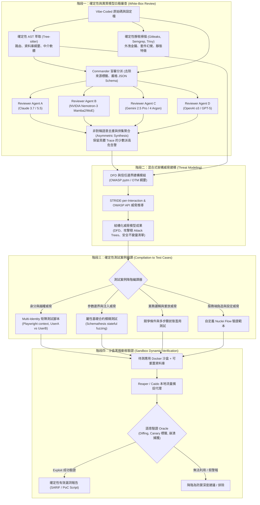

# Multi-Agent Vibe Coding 測試工具包：方法論與系統架構規劃報告

> **報告版本**：v1.0 (2026-10)  
> **研究依據**：基於 2024–2026 年最新學術實證（arXiv / USENIX / IEEE / ICML）、開源專案原始碼（GitHub）與官方 API 技術規範交叉核實。

---

## 摘要

針對 **Vibe Coding**（以自然語言提示驅動的高速 AI 生成應用）之程式碼特徵，本架構規劃一套**「以 Commander Agent 為測試基座（Harness），串聯異質多模型（Claude / Nemotron / Gemini / OpenAI）先白箱審查、後威脅建模再行黑箱驗證」**的自動化測試工具包。

本工具包核心特點：
1. **白箱階段**：利用 Tree-sitter 與靜態工具預萃取架構事實，分發至具備獨立 Context Window 的多家族模型進行盲審（Blind Review），消除自我偏好偏誤（Self-Preference Bias）；
2. **威脅建模階段**：由程式碼與資料流事實建構 DFD / 信任邊界，自動推導 STRIDE-per-Interaction 與 OWASP API Security Top 10 威脅；
3. **黑箱驗證階段**：將威脅宣告降階編譯（Lowering）為確定性測試腳本（Playwright 多帳號越權矩陣、Schemathesis 屬性模糊測試、併發條件競爭探針），於本機 Docker 沙盒中實施 Proof-by-Exploitation 實證。

---

## 目錄
1. [現狀開源專案與前沿文獻交叉驗證分析](#1-現狀開源專案與前沿文獻交叉驗證分析)
2. [不可行性聲明：做不到的事情（Honest Limitations）](#2-不可行性聲明做不到的事情honest-limitations)
3. [完整方法論：先白箱、後威脅建模、再黑箱驗證](#3-完整方法論先白箱後威脅建模再黑箱驗證)
4. [詳細系統架構設計（Multi-Agent System Architecture）](#4-詳細系統架構設計multi-agent-system-architecture)
5. [異質多模型（Heterogeneous Multi-LLM）適配與偏誤消除實作細節](#5-異質多模型heterogeneous-multi-llm適配與偏誤消除實作細節)
6. [威脅建模向執行期黑箱測試案例的降階編譯（Compilation Pipeline）](#6-威脅建模向執行期黑箱測試案例的降階編譯compilation-pipeline)
7. [推薦技術棧與實作里程碑（Roadmap）](#7-推薦技術棧與實作里程碑roadmap)

---

## 1. 現狀開源專案與前沿文獻交叉驗證分析

### 1.1 業界具代表性的開源專案驗證
* **[KeygraphHQ/shannon](https://github.com/KeygraphHQ/shannon)**：
  * **模式**：多階段「無 PoC 就不報告（Proof-by-Exploitation）」自主滲透 Agent。
  * **核心機制**：採用 Temporal 狀態機進行長任務持久化，白箱讀取原始碼映射路由與架構，黑箱驅動 [Playwright](https://github.com/microsoft/playwright) 與 [Schemathesis](https://github.com/schemathesis/schemathesis) 進行動態攻擊驗證，只產出被驗證成功的 Exploit。
* **[usestrix/strix](https://github.com/usestrix/strix)**：
  * **模式**：Graph-of-Agents 架構，運行於 Kali Docker 沙盒。
  * **核心機制**：整合 Caido 代理、Playwright、Python Exploit Runtime、[Semgrep](https://github.com/semgrep/semgrep) 與 [Nuclei](https://github.com/projectdiscovery/nuclei)，具備由白箱掃描推動黑箱驗證並生成修復 Pull Request（`strix fix`）的能力。
* **[ghostsecurity/reaper](https://github.com/ghostsecurity/reaper)**：
  * **模式**：針對 AI Agent 設計的 Headless MITM HTTP Proxy。
  * **核心機制**：透過 Unix Domain Socket 與 SQLite 儲存流量，使 Agent 不需被龐大的 HAR 封包洗版，即可精準搜尋並竄改 API 參數測試越權（BOLA/IDOR）。
* **[DARPA AIxCC 競賽開源系統](https://archive.aicyberchallenge.com/)**：
  * **[trailofbits/buttercup](https://github.com/trailofbits/buttercup)**（第二名）與 **[Team-Atlanta/aixcc-afc-atlantis](https://github.com/Team-Atlanta/aixcc-afc-atlantis)**（冠軍）：驗證了單純靠 LLM 無法可靠挖掘複雜記憶體/邏輯漏洞，必須將 LLM 與**確定性工具（Deterministic Tools：Fuzzing、Tree-sitter AST、ASan/MSan Sanitizers）**緊密閉環綁定。

### 1.2 Vibe Coding 應用特有漏洞的最新學術實證（2024–2026）
* **BaxBench（ETH Zurich, UC Berkeley, 2025，[arXiv:2502.11844](https://arxiv.org/abs/2502.11844)）**：
  評估 392 個後端生成任務發現：頂級推理模型（如 o1）功能正確率僅約 62%；而**在功能完全正確的後端程式碼中，約 50% 仍被實證 Exploit 成功攻破**。證明功能測試（Happy Path）通過與安全性毫無正相關。
* **SusVibes（CMU LeiLiLab, 2025，[arXiv:2512.03262](https://arxiv.org/abs/2512.03262)）**：
  在多檔案真實任務中，前沿編碼 Agent 產出的程式碼**僅 11.8%～15% 同時滿足功能正確與安全**。研究證實**僅在 Prompt 加入安全警語完全無效**。
* **Last Secure Code Benchmark — LSCB（2026，[arXiv:2610.14766](https://arxiv.org/abs/2610.14766)）**：
  在從零生成整個 Repo 的 Vibe Coding 場景下，程式碼安全通過率**驟降至 ~12%**。
* **野外真實漏洞模式（如 Lovable Supabase RLS 漏洞 `CVE-2025-48757` 及 Escape.tech 2025 掃描）**：
  Vibe Coding 最致命的弱點不在複雜演算法，而在：
  1. **資料庫 RLS（Row-Level Security）未開啟或設定為 `USING (true)`**，前端暴露公開 API key 即可任意 dump/改動全庫。
  2. **前端假裝認證（UI-only Gating）**：前端按鈕隱藏，但後端 API / Server Action 遺漏身分與權限校驗（IDOR/BOLA）。
  3. **前端打包外洩金鑰（Hardcoded Secrets）**：將 Stripe Secret、Service Role Key 誤寫入前端檔案或 `NEXT_PUBLIC_*` 環境變數。
  4. **套件幻覺（Slopsquatting，[arXiv:2406.10279](https://arxiv.org/abs/2406.10279)）**：LLM 隨機引入不存在的依賴套件。
  5. **狀態機邊界失效**：缺少防重放、競爭條件（Race Condition）保護或未校驗 Webhook 簽名。

---

## 2. 不可行性聲明：做不到的事情（Honest Limitations）

根據物理限制、軟體工程原理及學術界共識，以下事項**本工具包在設計上明確「做不到」**，必須依賴外在限制或確定性測試解決：

1. **做不到「靠投票消除所有模型共有盲點（Model Monoculture）」**：
   * *實證依據*：Kim et al. (*Correlated Errors in Large Language Models*, ICML 2025, [arXiv:2506.07962](https://arxiv.org/abs/2506.07962)) 評估 350+ 模型證實，不同廠商模型在犯錯時有高達 **~60% 的高度相關性**（受限於公開預訓練語料重疊）。
   * *結論*：如果某種安全反模式普遍存在於 GitHub，所有 LLM 都有可能一致看漏。因此，**絕對不能用多數決（Majority Vote）過濾告警，必須將 LLM 告警視為假說，用確定性工具驗證。**
2. **做不到「多 Agent 自由對話/辯論（Multi-Agent Debate）自然收斂出真理」**：
   * *實證依據*：Wynn et al. (*Talk Isn't Always Cheap*, 2025, [arXiv:2509.05396](https://arxiv.org/abs/2509.05396)) 與 Smit et al. ([arXiv:2311.17371](https://arxiv.org/abs/2311.17371)) 證實，多輪自由辯論極易觸發諂媚效應（Sycophancy）與錯誤傳播，強模型常向自信的弱模型妥協。
   * *結論*：本系統**不做自由聊天式群聊**，只做**嚴格盲審（Blind Review）+ 確定性沙盒覆核**。
3. **做不到「零知識純黑箱推導出未暴露的內部業務邏輯與影子 API」**：
   * *實證依據*：OWASP ASVS 5.0.0（2025 年 5 月正式版）已全面推翻「Level 1 控制項可純靠黑箱完成驗證」的假設。純黑箱在遇到無公開鏈接的影子 API（OWASP API9:2023）或複雜權限狀態時，必定產生嚴重的探測遺漏。
   * *結論*：黑箱階段必須**讀取白箱階段所萃取出的 API 結構與狀態規格**作為輸入，不可做純盲猜黑箱。
4. **做不到「在生產環境進行具破壞性的黑箱變異與越權探測」**：
   * 越權（IDOR/BOLA）測試與狀態機壓力測試必然涉及跨租戶寫入、資料庫刪除與並發請求。
   * *結論*：本工具包的黑箱階段**必須運行於隔離的 Docker 容器或 Staging 沙盒環境中**，配備資料庫快照以便每輪復原。

---

## 3. 完整方法論：先白箱、後威脅建模、再黑箱驗證



### 方法論四階段核心步驟：

#### 階段一：異質白箱審查（消除自我偏好與家族偏誤）
1. **確定性預處理**：
   * 利用 [Tree-sitter](https://github.com/tree-sitter/tree-sitter) 解析所有檔案之 CST，無需專案能順利編譯即可抽取出：API 路由表、RPC/Server Actions、資料庫 Schema（Prisma/Drizzle/SQL）、中介軟體（Middleware）鏈。
   * 利用 [Gitleaks](https://github.com/gitleaks/gitleaks) 掃描原始碼與前端建置產物（如 `.next/`, `dist/`）是否有外洩金鑰；利用 [Trivy](https://github.com/aquasecurity/trivy) 比對套件登錄庫，偵測 **Slopsquatting（虛構依賴套件）**。
2. **盲審分派（Blind Review Fan-out）**：
   * Commander 將程式碼 Diff 或關鍵函式，**抹除所有撰寫者標籤與環境資訊**，分派給各自擁有獨立 Context Window 的 Worker Agents。
   * 各 Worker 分別綁定不同模型家族：
     * **Claude (Anthropic)**：擅長程式碼語意脈絡與架構理解。
     * **NVIDIA Nemotron-3 (NIM / Mamba-2 + LatentMoE)**：具備非純 Transformer 的架構多樣性與 NVIDIA 專有強化學習對齊。
     * **Gemini (Google)**：百萬級 Token 原生上下文，長程控制流追蹤。
     * **OpenAI o3 / GPT 系列**：強邏輯鏈推理。
   * 強制 Worker 輸出嚴格 JSON Schema（包含 `cwe_id`, `file`, `line_range`, `sink_trace`, `exploit_hypothesis`, `confidence`）。
3. **消除自戀偏好（Self-Preference Bias，[arXiv:2404.13076](https://arxiv.org/abs/2404.13076)）**：
   * 寫程式的模型**不得作為唯一審查者**。各審查模型在生成結論前，**互不見面、無對話、不交換意見**，徹底阻斷社交諂媚（Sycophancy）。
4. **非對稱語意聚合（Asymmetric Synthesis）**：
   * 根據 [arXiv:2506.07962](https://arxiv.org/abs/2506.07962)，**絕不可採多數決剔除孤立告警**。若僅有 Nemotron 抓出某個 SQL 拼接或 RLS 漏洞，只要附帶合法的程式碼路徑證明（Sink Trace），該告警即進入下階段驗證隊列。

#### 階段二：混合式架構威脅建模（Threat Modeling）
1. **拒絕「純文字 Prompt 威脅建模」**：
   * 依據學術實證（[arXiv:2411.17058](https://arxiv.org/abs/2411.17058)），讓 LLM 對純文字描述發散思考會產生大量虛假清單。
2. **由代碼事實建構資料流圖（DFD as Code）**：
   * 將白箱抽出的路由、外部相依服務（如 Supabase, Stripe, S3）、認證中介軟體映射為 [OWASP pytm](https://github.com/izar/pytm) 或 [Open Threat Model (OTM)](https://github.com/iriusrisk/OpenThreatModel) 規格。
   * 明確標記**信任邊界（Trust Boundaries）**：
     * *邊界 A*：公網匿名使用者 $\rightarrow$ 前端 Next.js / React
     * *邊界 B*：前端 Client $\rightarrow$ 後端 API / Server Action
     * *邊界 C*：後端核心邏輯 $\rightarrow$ 資料庫 / 第三方 BaaS（如 Supabase PostgREST）
3. **STRIDE-per-Interaction 自動推導**：
   * 針對跨越信任邊界的每一條資料流（Flow），自動推導其安全性不變量（Security Invariants）：
     * **S (Spoofing)**：該 Flow 是否強制校驗 Session/JWT？
     * **T (Tampering)**：請求內容是否有型別與白名單驗證？是否存在未授權屬性覆寫（BOPLA / Mass Assignment）？
     * **I (Info Disclosure)**：回應內容是否回傳非屬當前使用者的私密欄位？
     * **E (Elevation of Privilege)**：租戶 A 是否可帶入租戶 B 的 Object ID 進行讀寫（BOLA/IDOR）？

#### 階段三：威脅模型向黑箱測試案例的降階編譯（Compilation Pipeline）
威脅建模的產物不是給人看的報告，而是**測試案例的產生依據**。將每條「威脅假說」自動轉譯為四類確定性測試套件：
1. **多身分越權測試（Multi-Identity Authz Matrix）**：針對所有標示為受保護的端點，配置 `Tenant_A`、`Tenant_B`、`Admin`、`Anonymous` 四組認證狀態，進行矩陣式交叉重放。
2. **屬性基礎 API 模糊測試（Property-Based Fuzzing）**：將萃取出的 OpenAPI 綱要送入 [Schemathesis](https://github.com/schemathesis/schemathesis)，自動測試資料型態極值、負向輸入阻擋與 500 錯誤監控。
3. **多步驟狀態機併發濫用**：針對電商結帳、點數扣除、票券核銷等業務流，編寫並發異步請求腳本測試條件競爭（Race Condition / TOCTOU）。
4. **專有 Nuclei 範本**：針對架構特徵（如特定 BaaS 端點、暴露的特定路由）生成可自動重放的 YAML 測試規則。

#### 階段四：沙盒黑箱動態驗證（Proof-by-Exploitation）
1. 在本機 Docker 中啟動待測應用程式與隔離的資料庫容器。
2. 透過 [ghostsecurity/reaper](https://github.com/ghostsecurity/reaper) 代理監聽所有請求與回應，將流量寫入本機 SQLite。
3. 執行測試腳本，由 **確定性 Oracle（如 Canary 標記比對、狀態碼對照、資料庫實質變異監控）** 判定攻擊是否成立。
4. **只輸出可重現的真實漏洞**（包含 curl 重現指令、Playwright 重現腳本、SARIF 格式資料），其餘無法利用的純靜態告警降階處理。

---

## 4. 詳細系統架構設計（Multi-Agent System Architecture）

依據 [Anthropic: Building Effective Agents](https://www.anthropic.com/engineering/building-effective-agents) 與 [UC Berkeley MAST (arXiv:2503.13657)](https://arxiv.org/abs/2503.13657) 的教訓，**外層工作流必須由確定性的有限狀態機（FSM / DAG）嚴格控制，LLM 僅負責節點內的語意決策，不可讓 LLM 自行決定外層迴圈何時結束**。

```
+---------------------------------------------------------------------------------------------------------+
|                                COMMANDER HARNESS CORE (Python / AsyncIO)                                |
|                                                                                                         |
|  +----------------------------------+  +---------------------------------+  +------------------------+  |
|  |     FSM Pipeline Orchestrator    |  |       Task & Artifact Ledger    |  |  Multi-Provider Router |  |
|  |  (Deterministic State Machine)   |  |   (SQLite / JSON Schema Store)  |  |  (LiteLLM + Native SDK)|  |
|  +----------------------------------+  +---------------------------------+  +------------------------+  |
+----------------------------------------------------+----------------------------------------------------+
                                                     |
            +----------------------------------------+----------------------------------------+
            |                                                                                 |
            v                                                                                 v
+-------------------------------+                                           +---------------------------------+
|   WHITE-BOX WORKER POOL       |                                           |     BLACK-BOX WORKER POOL       |
|   (Isolated Context Windows)  |                                           |     (Sandboxed Tool Drivers)    |
|                               |                                           |                                 |
|  +-------------------------+  |                                           |  +---------------------------+  |
|  | Agent A: Claude 3.7/5.5 |  |                                           |  | Schemathesis Fuzz Agent   |  |
|  +-------------------------+  |                                           |  +---------------------------+  |
|  +-------------------------+  |                                           |  +---------------------------+  |
|  | Agent B: Nemotron-3 NIM |  |                                           |  | Playwright Authz Agent    |  |
|  +-------------------------+  |                                           |  +---------------------------+  |
|  +-------------------------+  |                                           |  +---------------------------+  |
|  | Agent C: Gemini 2.5 Pro |  |                                           |  | Nuclei Runner Agent       |  |
|  +-------------------------+  |                                           |  +---------------------------+  |
|  +-------------------------+  |                                           |  +---------------------------+  |
|  | Agent D: OpenAI o3/GPT  |  |                                           |  | Concurrency Race Agent    |  |
|  +-------------------------+  |                                           |  +---------------------------+  |
+---------------+---------------+                                           +----------------+----------------+
                |                                                                            |
                v                                                                            v
+-------------------------------+                                           +---------------------------------+
| DETERMINISTIC WHITE-BOX TOOLS |                                           | RUNTIME EXECUTION SANDBOX       |
|                               |                                           |                                 |
| - Tree-sitter (CST Extraction)|                                           | - Ephemeral App Docker Container|
| - Gitleaks (Secret Detection) |                                           | - PostgreSQL/SQLite with Snapshots
| - Trivy (Package Validation)  |                                           | - Reaper MITM Proxy Daemon      |
| - Semgrep (Custom SAST Rules) |                                           | - Network Isolated Namespace    |
+-------------------------------+                                           +---------------------------------+
```

### 4.1 核心元件職責劃分

1. **Commander Agent (Harness Core)**：
   * **角色**：指揮官，負責系統生命週期與排程。
   * **機制**：維持一組 `TaskLedger` 與 `StateGraph`。白箱開始時，建立乾淨的 Prompt 模板，分發給 4 個不同模型家族的 Worker；收集輸出後執行語意去重（Deduplication）並建立總體威脅候選池。
   * **安全性邊界**：負責過濾傳入 Worker 的 Context，防止 Prompt Injection；強制所有 Worker 透過 Structured Outputs 返回結構化資料。
2. **White-Box Reviewer Workers (異質審查叢集)**：
   * 各 Worker 只能存取 Commander 提供的程式碼片段與 Tree-sitter 摘要，無法窺探其他 Worker 的即時推論過程。
   * Worker 針對特定面向產出假說（例如：身分驗證缺失、資料庫未啟用 RLS、金鑰暴露）。
3. **Threat Modeler (威脅建模轉換器)**：
   * 結合確定性資料流（DFD）與 Worker 提出的高風險注入點，生成形式化的威脅清單（STRIDE-per-Interaction）。
   * 將抽象威脅降低（Lowering）為具體的測試宣告（Test Assertions）。
4. **Black-Box Testing Harness (動態測試沙盒與驅動器)**：
   * 控制 Docker Daemon 啟動乾淨的待測環境，注入測試帳號（Tenant A, Tenant B, Admin）。
   * 驅動執行測試腳本，透過本地 Reaper 代理捕捉網路流量，以 Oracle 模組驗證漏洞是否屬實。

---

## 5. 異質多模型（Heterogeneous Multi-LLM）適配與偏誤消除實作細節

為確保白箱測試階段真正達成「不同模型交叉消融偏誤」，各模型必須採取正確的原生 API / 參數呼叫：

### 5.1 具體驗證之模型配置矩陣

| 模型家族 | 實體驗證之 Model ID | 呼叫端點與方式 | 結構化輸出機制 | 在工具包中的特化分工 |
| :--- | :--- | :--- | :--- | :--- |
| **Anthropic Claude** | `claude-sonnet-5-5` / `claude-opus-5-5` | `https://api.anthropic.com/v1/messages` (SDK: `anthropic`) | `anthropic-beta: structured-outputs-2025-11-13` 或 `output_config` JSON Schema | 審查複雜控制流、非同步事件處理、前端 React 狀態陷阱 |
| **NVIDIA Nemotron** | `nvidia/nemotron-3-super-120b-a12b` 或 `nvidia/llama-3.3-nemotron-super-49b-v1.5` | `https://integrate.api.nvidia.com/v1` (NVIDIA NIM，相容 OpenAI SDK) 或本地 vLLM | OpenAI 相容之 `response_format={"type": "json_schema", ...}` (經 xgrammar 加速) | 提供非純 Transformer 的架構多樣性（Mamba-2/MoE 混合），減少純美系主流模型的對齊盲點 |
| **Google Gemini** | `gemini-2.5-pro` / `gemini-4-argon` | `https://generativelanguage.googleapis.com` (SDK: `google-genai`) | `GenerateContentConfig(response_mime_type="application/json", response_schema=PydanticModel)` | 利用超長上下文進行跨多檔案（路由、ORM、Schema、Middleware）全域關聯分析 |
| **OpenAI GPT / o-Series** | `o3` / `gpt-5.4` / `gpt-6.1-sol` | `https://api.openai.com/v1/responses` 或 `/v1/chat/completions` (SDK: `openai`) | `responses` 之 `text={"format": {"type": "json_schema", ...}}` | 深度多步邏輯演繹、邊界條件極值推演 |

### 5.2 呼叫適配層（Unified Adapter Layer）的設計防護
雖然可以使用 [LiteLLM (`BerriAI/litellm`)](https://github.com/BerriAI/litellm) 作為統一轉發層，但本工具包在適配層必須實作三項關鍵防護：
1. **思考標記分離（Reasoning Content Separation）**：
   * 當使用具備原生思考能力的模型（如 OpenAI `o3`、Gemini 思考模式、或開啟 `detailed thinking` 的 Nemotron）時，必須確保 `<think>` 內容與最終 JSON 嚴格分流，避免思考文字污染 JSON Schema 解析器造成崩潰。
2. **Schema 嚴格性交集處理**：
   * OpenAI 與 Anthropic 嚴格要求 JSON Schema 內必須宣告 `"additionalProperties": false` 且所有欄位列入 `"required"`；Gemini 對預設值較寬容。適配層統一發送最嚴格的 JSON Schema 子集。
3. **金鑰與網路連線防護**：
   * 支援本地 vLLM / Ollama 離線推論（尤其是開源權重的 Nemotron-3 Nano / Super 模型），滿足敏感情境下程式碼不外流的需求。

---

## 6. 威脅建模向執行期黑箱測試案例的降階編譯（Compilation Pipeline）

威脅建模若不能自動轉為可執行的測試，就會淪為無用的擺設。本工具包採用**四段式降階編譯（Lowering Process）**：

```
[原始程式碼 AST + 設定檔]
         │
         ▼ (階段 1: 結構化擷取)
[系統資料流結構 (OTM / pytm DFD)]
  - 邊界: Browser -> API Gateway -> Database
  - 資料流: POST /api/teams/:id/members [Bearer Token]
         │
         ▼ (階段 2: 威脅推導與不變量判定)
[STRIDE-per-Interaction 威脅宣告]
  - 威脅 ID: TM-ATHZ-01 (Elevation of Privilege)
  - 描述: 租戶 A 帶入租戶 B 之 team_id 執行成員新增
  - 不變量: Current_User.team_id == Request.params.team_id
         │
         ▼ (階段 3: 降階編譯器 Lowering)
[可執行測試套件生成]
  ├── Playwright Authz Matrix Script (多身分權限測試)
  ├── Schemathesis Property Definition (邊界與型別測試)
  └── Concurrency Stress Script (競爭條件測試)
         │
         ▼ (階段 4: 沙盒動態執行與 Oracle 斷言)
[執行結果: HTTP 403 (Pass) 或 HTTP 200 + 成功寫入 (Exploited!)]
```

### 6.1 測試套件的具體映射與實作細節

#### 1. 越權與身分偽造（Elevation of Privilege / Spoofing $\rightarrow$ Multi-Identity Matrix）
* **受測漏洞**：BOLA / IDOR（OWASP API1:2023）、BFLA（API5:2023）、BaaS RLS 遺漏（如 `CVE-2025-48757`）。
* **生成機制**：
  * 編譯器生成一個 [Playwright](https://playwright.dev/) API 測試腳本，利用 `browser.newContext({ storageState: 'userA.json' })` 與 `userB.json`。
  * **執行流程**：
    1. 以 User A 身分調用 `POST /api/documents` 建立敏感資源，擷取 `doc_id_123`。
    2. 切換為 User B 身分，調用 `GET /api/documents/doc_id_123` 及 `PUT /api/documents/doc_id_123`。
    3. **安全 Oracle 斷言**：
       * 不僅檢查狀態碼（必須為 `403 Forbidden` 或 `404 Not Found`）。
       * 進行 **語意 Diffing**：若返回 `200 OK`，比對回應 JSON 是否包含 User A 特有的 Canary 標記字串；若有，即確認漏洞存在。

#### 2. 輸入竄改與大量指派（Tampering $\rightarrow$ Property-Based Fuzzing）
* **受測漏洞**：BOPLA / Mass Assignment（API3:2023）、SQLi、路徑穿越。
* **生成機制**：
  * 從原始碼提取出的型別定義（如 Zod Schema、Pydantic、Prisma）生成臨時的 `openapi.yaml`。
  * 呼叫 [Schemathesis](https://github.com/schemathesis/schemathesis) 執行狀態機模糊測試：
    ```bash
    schemathesis run ./generated_openapi.yaml \
      --checks not_a_server_error,status_code_conformance,negative_data_rejection \
      --base-url http://localhost:3000
    ```
  * 自動注入負向資料（極大整數、特殊符號、未宣告之管理員欄位 `isAdmin: true`、`role: "superadmin"`），檢驗伺服器是否異常崩潰（500）或成功覆寫未授權欄位。

#### 3. 業務流與並發漏洞（Repudiation / Denial of Service $\rightarrow$ Concurrency Abuse）
* **受測漏洞**：點數雙重花費（Double-Spending）、折價券重複兌換、條件競爭（TOCTOU）。
* **生成機制**：
  * 編譯出 Python `asyncio` + `httpx` 腳本，向目標端點發送 20~50 個微秒級同步並發封包（利用 HTTP/2 多路複用與 TCP 視窗對齊技術）。
  * 比對操作前後資料庫餘額變化，驗證資料庫交易隔離等級（Transaction Isolation）是否足以抵禦並發攻擊。

---

## 7. 推薦技術棧與實作里程碑（Roadmap）

### 7.1 工具包技術棧選型

| 模組 | 推薦採用之技術 / 框架 | 理由與選型依據 |
| :--- | :--- | :--- |
| **Commander / FSM 基座** | Python 3.11+ / `asyncio` 自研 FSM 或 LangGraph 核心圖 | 避免 chatty 型 agent 的不穩定性，擁有絕對的流程控制權與狀態持久化 |
| **白箱語法分析** | `tree-sitter` (多語言) + `semgrep` CLI | 輕量且無需建置編譯環境即可抽取出精準的路由與 AST 結構 |
| **金鑰與套件安全** | `gitleaks` + `trivy` | 確定性偵測 Vibe Coding 常見的打包金鑰洩漏與套件幻覺 |
| **多模型統一適配** | `litellm` + 原生 SDK 備援 | 支援 Anthropic, Google GenAI, OpenAI 與 NVIDIA NIM |
| **威脅模型表達** | 自定義 Pydantic 結構 (相容 OWASP `pytm` / OTM) | 便於將 DFD 與 STRIDE 矩陣向下編譯為測試腳本 |
| **黑箱流量監聽與重放** | [ghostsecurity/reaper](https://github.com/ghostsecurity/reaper) | 專為 CLI / Agent 設計的輕量 MITM Proxy，以 SQLite 結構化存取流量 |
| **動態測試執行器** | [Playwright](https://playwright.dev/) + [Schemathesis](https://github.com/schemathesis/schemathesis) | 成熟的瀏覽器/API 雙棲自動化環境，支援完整的 multi-session context |
| **沙盒環境** | Docker Engine + Docker-in-Docker / 本地容器 | 確保動態變異攻擊完全隔離，並支援快速資料庫重置 |

### 7.2 實作開發四階段里程碑

* **階段一：MVP 基礎架構建立（Core Harness & White-Box Swarm）**
  * 實作 Commander FSM 主迴圈。
  * 整合 Tree-sitter 與 Gitleaks 進行專案結構預分析。
  * 實作多模型適配器，完成 Claude、Nemotron (NIM)、Gemini、OpenAI 的盲審並行分發與 JSON Schema 強制輸出。
  * 驗證非對稱聚合（Asymmetric Synthesis）去重邏輯。
* **階段二：威脅建模引擎（Threat Modeling Module）**
  * 實作從 AST 資訊自動產生 DFD、識別信任邊界（Trust Boundaries）的演算法。
  * 建立 STRIDE-per-Interaction 規則庫與 OWASP API Security Top 10 映射表。
  * 產出結構化的威脅模型 JSON 中介檔。
* **階段三：黑箱編譯器與沙盒（Compilation Pipeline & Sandbox）**
  * 實作將威脅宣告降階編譯為 Playwright 多帳號驗證腳本及 Schemathesis 設定的程式碼生成器。
  * 整合 Docker 管理模組，提供待測應用的本地一鍵部署與 DB 快照重置機制。
  * 串接 Reaper Proxy 捕捉執行期流量。
* **階段四：驗證閉環與報告產出（Exploit Oracle & Reporting）**
  * 實作基於 Canary 與語意比對的 Exploit Oracle。
  * 產出符合業界標準的 SARIF 2.1.0 檔案、Markdown 審查報告及可重現漏洞的 `curl` / `playwright` 測試代碼。
  * 在典型 Vibe Coding 框架專案（如 Next.js + Supabase 應用）進行端到端基準測試。
